# PeopleDesk – Highly Available Employee Management on AWS

**English** | [Türkçe](README.tr.md)

> A stateless Node.js employee management application deployed across **two Availability Zones** in **eu-central-1 (Frankfurt)**, behind an **Application Load Balancer**, running on an **EC2 Auto Scaling group** in private subnets and backed by an **Amazon Aurora MySQL** cluster with a writer and a reader. Database credentials come from **AWS Secrets Manager** through an **IAM instance role**, and administrative access goes through **Systems Manager Session Manager** instead of SSH.


---

## Table of contents

- [A. Project overview](#a-project-overview)
- [B. Architecture diagram](#b-architecture-diagram)
- [C. AWS services used](#c-aws-services-used)
- [D. Network architecture](#d-network-architecture)
- [E. Application architecture](#e-application-architecture)
- [F. Database architecture](#f-database-architecture)
- [G. Security design](#g-security-design)
- [H. High availability and failover testing](#h-high-availability-and-failover-testing)
- [I. Screenshots](#i-screenshots)
- [J. Deployment and configuration](#j-deployment-and-configuration)
- [K. Testing](#k-testing)
- [L. Cost considerations](#l-cost-considerations)
- [M. Lessons learned](#m-lessons-learned)
- [N. Future improvements](#n-future-improvements)

---

## A. Project overview

**PeopleDesk** is an HR web application for managing employees and departments. HR staff can browse an employee directory with search, filtering, sorting and pagination. They can add, view, edit and delete employee records, export the directory to CSV, and see dashboard metrics such as headcount by department and recent hires. A **System Status** page shows which EC2 instance and Availability Zone served the request, the live health and readiness status, and a load-distribution test through the ALB.

**Why this project exists.** I built PeopleDesk as a hands-on AWS Solutions Architecture portfolio project. The application is intentionally simple: Node.js and vanilla JavaScript, with no build step. The focus is the infrastructure around it and the application-level decisions that make a multi-AZ deployment work in practice.

**Architectural objectives**

| Objective | How it is addressed |
| --- | --- |
| **High availability** | Application instances in two AZs behind an ALB; Aurora writer and reader in a Multi-AZ cluster |
| **Fault tolerance** | The Auto Scaling group replaces failed instances. Aurora fails over to the reader, and the app reconnects through the cluster writer endpoint |
| **Security** | Private subnets for compute and database, chained security groups, Secrets Manager with an IAM role, no SSH |
| **Scalability** | Stateless application tier behind an ALB, so instances can be added or removed at any time |
| **Operability** | Separate `/health` (liveness) and `/ready` (database readiness) endpoints, structured JSON logs, systemd service, scripted installation |

---

## B. Architecture diagram

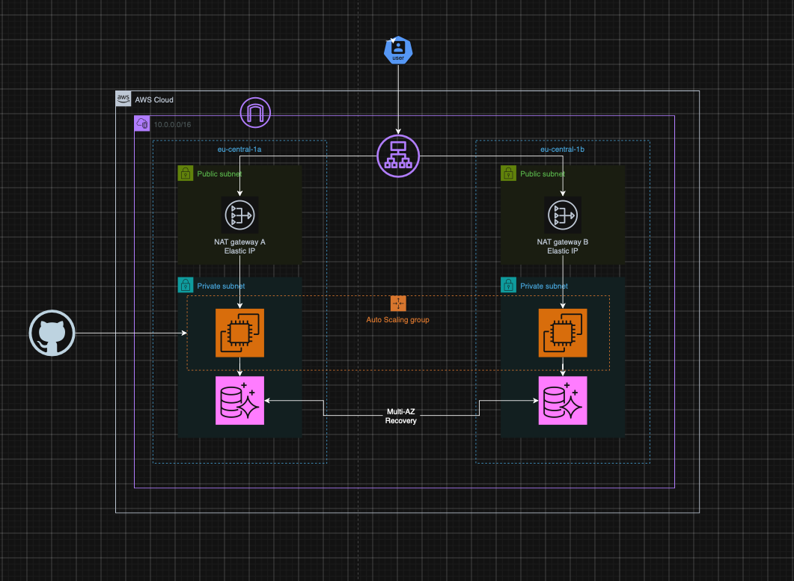

The Mermaid diagram below adds resource names, ports, security groups and the regional services:

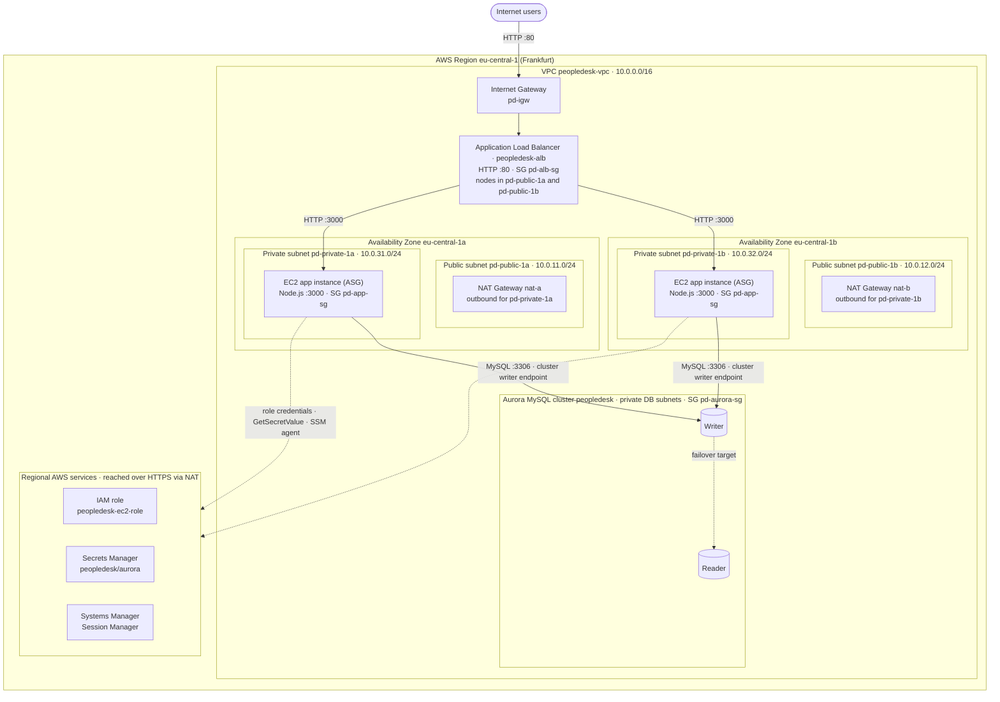

**Notes on the diagram**

- The two EC2 instances are managed by a single **EC2 Auto Scaling group** that spans `pd-private-1a` and `pd-private-1b`. They are registered in the target group `peopledesk-tg`.
- Writer and reader roles are **not tied to a specific instance**. After the failover test, the instance named `peopledesk-instance-1-reader` became the writer (see [section H](#h-high-availability-and-failover-testing)).
- Traffic from the instances to Secrets Manager and Systems Manager leaves through the NAT gateway in the same AZ. No VPC interface endpoints are used.

A higher-level design write-up is available in [docs/architecture.md](docs/architecture.md).

---

## C. AWS services used

| AWS service | Purpose in PeopleDesk | Why it was selected |
| --- | --- | --- |
| **Amazon VPC** | Isolated network `peopledesk-vpc` (10.0.0.0/16) with 2 public and 2 private subnets in two AZs | Gives full control over routing and network boundaries; separating public from private subnets is the base of the security model |
| **Internet Gateway** (`pd-igw`) | Internet connectivity for the public subnets | Required for the internet-facing ALB and for the NAT gateways' outbound path |
| **NAT Gateway** (`nat-a`, `nat-b`) | Outbound-only internet access for private instances (package installation, GitHub clone, AWS APIs) | Instances stay unreachable from the internet. One zonal NAT per AZ removes the cross-AZ dependency on a single NAT |
| **Application Load Balancer** (`peopledesk-alb`) | Single public entry point on HTTP :80, forwarding to `peopledesk-tg` on port 3000 | Layer 7 load balancing across AZs, built-in health checks, and automatic removal of unhealthy targets. Stickiness is off because the app is stateless |
| **Amazon EC2** | Runs the Node.js/Express application (Amazon Linux 2023, `t2.nano` in this lab) | Simple, transparent compute that shows the full stack: OS, systemd and networking |
| **EC2 Auto Scaling** | Keeps the desired number of application instances across both private subnets | Self-healing: a stopped or failed instance is replaced automatically, as shown in testing |
| **Amazon Aurora MySQL** | Cluster `peopledesk` with a writer and a reader instance (`db.t3.small`) | Managed MySQL-compatible database with storage replicated across AZs and automatic failover to a reader |
| **AWS Secrets Manager** | Stores the application DB credentials and endpoint in the secret `peopledesk/aurora` | Keeps credentials out of code, AMIs, user data and Git. Access is controlled by IAM and audited |
| **AWS IAM** | Role `peopledesk-ec2-role` attached to the instances through an instance profile | Gives temporary, automatically rotated credentials to the AWS SDK. No access keys on the servers |
| **AWS Systems Manager – Session Manager** | Shell access to the private instances | No bastion host, no SSH keys and no inbound port 22. Access is controlled by IAM |
| **Security Groups** | Stateful firewalls for the ALB, app and DB tiers | Chained by security-group references: each tier only accepts traffic from the tier in front of it |

---

## D. Network architecture

### VPC and subnet design

| Subnet | AZ | CIDR | Route table | Default route | Hosts |
| --- | --- | --- | --- | --- | --- |
| `pd-public-1a` | eu-central-1a | 10.0.11.0/24 | `pd-public-rt` | `0.0.0.0/0 → pd-igw` | ALB node, NAT gateway `nat-a` |
| `pd-public-1b` | eu-central-1b | 10.0.12.0/24 | `pd-public-rt` | `0.0.0.0/0 → pd-igw` | ALB node, NAT gateway `nat-b` |
| `pd-private-1a` | eu-central-1a | 10.0.31.0/24 | `pd-private-rt` | `0.0.0.0/0 → nat-a` | EC2 app instance, Aurora instance (via DB subnet group) |
| `pd-private-1b` | eu-central-1b | 10.0.32.0/24 | `pd-private-rt2` | `0.0.0.0/0 → nat-b` | EC2 app instance, Aurora instance (via DB subnet group) |

All route tables also contain the implicit `10.0.0.0/16 → local` route.

### Public and private responsibilities

- **Public subnets** host only internet-facing infrastructure: the ALB and the NAT gateways. No application server or database runs there.
- **Private subnets** host the EC2 application instances and the Aurora instances. They have no public IP addresses and no route from the internet.

### Internet Gateway, NAT Gateways and route tables

- **One public route table** is enough because both public subnets use the same regional Internet Gateway.
- **Each private subnet has its own route table** that points to the NAT gateway **in its own AZ**. A route table can have only one `0.0.0.0/0` target. With a single shared private route table, both AZs would depend on one NAT gateway, and losing that AZ would cut outbound access for the healthy AZ too.
- The NAT gateways are **zonal**, each with an Elastic IP.

### Traffic flow

1. **Inbound request:** User → Internet Gateway → ALB (`pd-alb-sg`, HTTP :80) → one of the healthy targets in `peopledesk-tg` (HTTP :3000, `pd-app-sg`).
2. **Database access:** EC2 → Aurora **cluster writer endpoint** on TCP 3306 (`pd-aurora-sg`), inside the VPC.
3. **Outbound from instances:** EC2 → NAT gateway in the same AZ → Internet Gateway. This path is used to:
   - install packages and clone the repository at boot (user data);
   - call the Secrets Manager API;
   - register the SSM agent.
4. **Return traffic** is allowed automatically because security groups are stateful.

### Security group rules

| Security group | Inbound rule | Source | Purpose |
| --- | --- | --- | --- |
| `pd-alb-sg` | HTTP TCP 80 | `0.0.0.0/0` | Public web traffic to the ALB |
| `pd-app-sg` | TCP 3000 | `pd-alb-sg` (security group reference) | Only the ALB can reach the application port |
| `pd-aurora-sg` | MySQL/Aurora TCP 3306 | `pd-app-sg` (security group reference) | Only application instances can reach the database |

Rules reference **security group IDs instead of IP ranges**, so they stay valid when the Auto Scaling group replaces instances and their private IPs change.

---

## E. Application architecture

### Overview

A single Node.js process per instance serves both the static frontend and the REST API on port 3000. There is no server-side session state: every request can be handled by any instance, which is what allows round-robin load balancing without sticky sessions.

| Layer | Technology | Location |
| --- | --- | --- |
| Frontend | HTML5, CSS3, vanilla JavaScript (Fetch API, hash routing), no build step | [`frontend/`](frontend) |
| Backend | Node.js 20, Express 4, Helmet, compression | [`backend/`](backend) |
| Database driver | `mysql2/promise` connection pool | [`backend/src/db/pool.js`](backend/src/db/pool.js) |
| AWS SDK | AWS SDK for JavaScript v3 (`@aws-sdk/client-secrets-manager`) | [`backend/src/config/secrets.js`](backend/src/config/secrets.js) |
| Process management | systemd unit with automatic restart and sandboxing | [`deployment/employee-management.service`](deployment/employee-management.service) |

### Backend structure

```
backend/
├── server.js                 HTTP server, keep-alive tuning, graceful shutdown, DB warm-up
└── src/
    ├── app.js                Middleware chain: request context → health → security headers → /api → static files
    ├── config/               Environment configuration + Secrets Manager loader
    ├── routes/               URL → controller mapping
    ├── controllers/          HTTP concerns (status codes, CSV export)
    ├── validation/           Input validation and normalization
    ├── services/             Business logic and parameterized SQL
    ├── db/pool.js            Connection pool, retries, failover handling, credential refresh
    ├── middleware/           Request ID / access log, async handler, central error handler
    └── utils/                JSON logger, error classes
```

The frontend only uses **relative URLs** (`/api/...`), so it works behind any ALB DNS name without configuration.

### REST API

| Method | Path | Description |
| --- | --- | --- |
| GET | `/health` | Liveness. Returns 200 while the process is running. **Used by the ALB target group health check.** No database dependency |
| GET | `/ready` | Readiness. Returns 200 and the DB role (`writer` / `reader`) when Aurora is reachable, 503 otherwise |
| GET | `/api/dashboard` | Totals, headcount by department, recent hires |
| GET | `/api/employees` | List with `search`, `department`, `status`, `sortBy`, `sortOrder`, `page`, `pageSize` |
| GET | `/api/employees/export` | CSV export with the same filters |
| GET | `/api/employees/:id` | Single employee |
| POST | `/api/employees` | Create an employee |
| PUT | `/api/employees/:id` | Update an employee |
| DELETE | `/api/employees/:id` | Delete an employee |
| GET | `/api/departments` | Departments with headcount |
| GET | `/api/instance` | Instance ID, AZ and instance type that served the request (via IMDSv2) |

Request and response examples, validation rules and error codes: [docs/api-documentation.md](docs/api-documentation.md).

### Health vs. readiness

The two endpoints deliberately check different things:

- **`/health` is the ALB health check** and does not touch the database ([`healthController.js`](backend/src/controllers/healthController.js)). If it depended on Aurora, a short database failover would make *every* instance fail its health check at once, and the ALB would have no healthy targets left. A brief database interruption would turn into a full outage.
- **`/ready`** runs `SELECT 1, @@innodb_read_only` against the cluster. It shows whether the database is reachable and whether the connection reached a writer. It is used for verification and troubleshooting.

### How database credentials are retrieved

1. The installer writes `AWS_SECRET_NAME=peopledesk/aurora` and `AWS_REGION` into `/etc/employee-management/app.env`. That file contains no password.
2. At startup, [`secrets.js`](backend/src/config/secrets.js) calls `GetSecretValue` with the AWS SDK v3. The SDK's default credential chain takes temporary credentials from the **EC2 instance profile** through IMDS.
3. The secret JSON (`username`, `password`, `host`, `port`, `database`) is used to build the `mysql2` pool. Fields missing from the secret fall back to `DB_*` environment variables.
4. If Aurora rejects the credentials (`ER_ACCESS_DENIED_ERROR`), for example after a password rotation, the pool re-reads the secret (at most once every 30 seconds) and rebuilds itself.

For local development without AWS, `AWS_SECRET_NAME` is left empty and the app reads `DB_*` values from a git-ignored `.env` file.

---

## F. Database architecture

### Aurora cluster

| Item | Value |
| --- | --- |
| Cluster identifier | `peopledesk` |
| Instances | `peopledesk-instance-1`, `peopledesk-instance-1-reader` |
| Instance class | `db.t3.small` |
| Engine | Aurora MySQL (MySQL-compatible). The schema supports Aurora MySQL 2.x (MySQL 5.7) and 3.x (MySQL 8.0). Exact engine version: *to be documented* |
| Subnets | DB subnet group across `pd-private-1a` and `pd-private-1b` |
| Network access | Not publicly accessible; `pd-aurora-sg` allows 3306 only from `pd-app-sg` |
| Database / tables | `employee_management` with `departments` and `employees` ([`database/schema.sql`](database/schema.sql)) |

### Writer and reader roles

- The **writer** handles all reads and writes from PeopleDesk.
- The **reader** keeps an up-to-date view of the same cluster volume and is the **failover target**. Aurora storage is shared by all instances in the cluster, so promoting the reader does not require copying data.
- PeopleDesk currently sends **all traffic to the writer**. Sending read-only queries to the reader endpoint is listed under future improvements.

### Writer endpoint vs. reader endpoint vs. instance endpoints

| Endpoint | Format | Points to | Used by PeopleDesk |
| --- | --- | --- | --- |
| Cluster (writer) endpoint | `peopledesk.cluster-xxxx.eu-central-1.rds.amazonaws.com` | The **current** writer | **Yes** (stored in the secret's `host` field) |
| Reader endpoint | `peopledesk.cluster-ro-xxxx.eu-central-1.rds.amazonaws.com` | Reader instance(s) | No |
| Instance endpoint | `peopledesk-instance-1.xxxx.eu-central-1.rds.amazonaws.com` | One specific instance, whatever its role | No |

**Why the cluster writer endpoint:** an instance endpoint is tied to a physical instance, not a role. In the failover test, `peopledesk-instance-1` changed from writer to reader. An application connected to its instance endpoint would then send writes to a read-only instance. The cluster endpoint is a DNS name that Aurora updates to the new writer during failover, so the application configuration never changes.

### How failover affects the application

During a failover, existing connections to the old writer are dropped, or reach an instance that is now read-only. [`pool.js`](backend/src/db/pool.js) handles this as follows:

- **Broken or read-only connections are destroyed.** Fatal errors and `ER_OPTION_PREVENTS_STATEMENT` connections are not returned to the pool. New connections resolve the cluster endpoint again and reach the new writer.
- **Retries with exponential backoff** (default 3 retries, starting at 250 ms):
  - Connection-phase errors are retried for every query.
  - Errors in the middle of a query are retried **only for idempotent reads**. A write that lost its connection may already have committed, so it is not replayed blindly.
- **When retries run out**, the API returns `503 DATABASE_UNAVAILABLE` with `Retry-After: 5`, and the UI shows a retry message. `/health` stays 200, so the ALB keeps all instances in service.
- **No restart is needed.** The pool reconnects automatically once the new writer is available.

---

## G. Security design

### Network isolation

- Application instances and Aurora run in **private subnets** with no public IP addresses.
- The ALB is the only internet-facing component, and it only exposes HTTP :80.
- Security groups form a chain: **internet → `pd-alb-sg` (80) → `pd-app-sg` (3000) → `pd-aurora-sg` (3306)**.

### IAM role attached to EC2

The role `peopledesk-ec2-role` has two policies:

| Policy | Type | Purpose |
| --- | --- | --- |
| `AmazonSSMManagedInstanceCore` | AWS managed | Lets the SSM agent register the instance for Session Manager |
| `PeopleDeskSecretsAccess` | Customer inline | Allows `secretsmanager:GetSecretValue` for the PeopleDesk secret |

Intended scope of the inline policy, with the account ID redacted:

```json
{
  "Version": "2012-10-17",
  "Statement": [
    {
      "Effect": "Allow",
      "Action": "secretsmanager:GetSecretValue",
      "Resource": "arn:aws:secretsmanager:eu-central-1:<account-id>:secret:peopledesk/aurora-*"
    }
  ]
}
```

### Secrets Manager integration and no hardcoded credentials

- The repository contains **no credentials**. `.env` and `*.pem` files are excluded by [`.gitignore`](.gitignore); only `.env.example` with placeholder values is committed.
- The EC2 user data and `/etc/employee-management/app.env` only contain the **secret name** and region. The password lives in Secrets Manager.
- The application authenticates to AWS with **temporary role credentials**. No access keys exist on the instances.
- The database user `app_user` only has `SELECT, INSERT, UPDATE, DELETE` on `employee_management.*`. The Aurora master user is used only for the one-time schema setup.
- Connections to Aurora use **TLS** with the Amazon RDS CA bundle, downloaded by the installer (`DB_SSL=true`).

### Session Manager instead of SSH

- No key pair is attached to the instances, and **no security group allows port 22**.
- Shell access goes through Session Manager. The SSM agent opens an **outbound** connection through the NAT gateway, so no inbound rule is required, and access is governed by IAM.

### Application and host hardening

- **HTTP:** Helmet security headers, a Content Security Policy (`script-src 'self'`) and a 50 KB JSON body limit.
- **Input and SQL:** strict server-side validation and parameterized SQL, with a whitelisted `ORDER BY`. CSV export is protected against formula injection.
- **Host:** the service runs as a dedicated non-login `nodeapp` user with systemd sandboxing (`ProtectSystem=strict`, `NoNewPrivileges`, `PrivateTmp`). `app.env` is readable only by `root:nodeapp` (0640).

### Least privilege: what should be restricted further

| Area | Current state | Recommended tightening |
| --- | --- | --- |
| Inline secret policy | Grants `GetSecretValue` for the PeopleDesk secret | Verify the `Resource` is the exact secret ARN (no wildcard secrets). If a customer-managed KMS key is used, add `kms:Decrypt` scoped to that key only |
| `AmazonSSMManagedInstanceCore` | Broad AWS managed policy | Acceptable for a lab. In production, consider a custom policy limited to the Session Manager actions in use |
| Security group egress | Default "all traffic" outbound rule | Limit `pd-app-sg` egress to 443 (AWS APIs, packages) and 3306 to `pd-aurora-sg` |
| Transport to users | HTTP only on the ALB | Add an HTTPS listener with an ACM certificate and redirect 80 → 443 |
| Public exposure of the ALB | `0.0.0.0/0` on port 80 | Add AWS WAF managed rules and rate limiting |
| Authentication | The application has **no user authentication** | Add an identity layer (for example Amazon Cognito) before handling real HR data |
| Database credentials | Static `app_user` password | Enable Secrets Manager rotation. The app already reloads credentials after an authentication failure |

---

## H. High availability and failover testing

Two failure scenarios were tested manually in the deployed environment. Each test lists what was **observed in the screenshots** separately from what is only **expected** behavior.

### Test 1 – EC2 instance failure and Auto Scaling recovery

| | |
| --- | --- |
| **Objective** | Verify that the ALB stops routing to a failed instance, that the application stays reachable through the remaining AZ, and that the Auto Scaling group restores the desired capacity |
| **Baseline** | Both targets `i-0baa9be4f2acc7f70` (eu-central-1a) and `i-040c334fa400c1b15` (eu-central-1b) were **healthy** in `peopledesk-tg`. The System Status distribution test split 20 requests 10/10 across the two instances ([tg.png](screenshots/aws_console_screenshots/tg.png), [system_status.png](screenshots/project_screenshots/system_status.png)) |
| **Procedure** | 1. Stop instance `i-0baa9be4f2acc7f70` in eu-central-1a from the EC2 console.<br/>2. Watch the target group.<br/>3. Open PeopleDesk through the ALB DNS name.<br/>4. Watch the EC2 instance list for Auto Scaling activity |
| **Expected result** | The stopped target leaves service, and the ALB sends all traffic to the healthy instance. The Auto Scaling group detects the unhealthy instance, terminates it and launches a replacement. The replacement passes the `/health` check and starts receiving traffic |

**Observed result**

1. The instance entered the **Stopping** state ([test_ss_1](screenshots/ec2_failover_test%28alb%26asg%29/test_ss_1.png)).
2. `peopledesk-tg` showed **1 healthy** target (`i-040c334fa400c1b15`, eu-central-1b). The stopped target was reported as *"Target is in the stopped state"* and removed from routing ([test_ss_2](screenshots/ec2_failover_test%28alb%26asg%29/test_ss_2.png)).
3. PeopleDesk stayed reachable through the ALB and was served by `i-040c334fa400c1b15` in eu-central-1b, with `/health` 200 and `/ready` 200 ([test_ss_3](screenshots/ec2_failover_test%28alb%26asg%29/test_ss_3.png)).
4. The Auto Scaling group **terminated** the stopped instance and **launched a replacement**, `i-0956ab0c75d167968`, in eu-central-1a ([test_ss_4](screenshots/ec2_failover_test%28alb%26asg%29/test_ss_4.png)).
5. Later, the distribution test split 20 of 20 requests 10/10 between the replacement `i-0956ab0c75d167968` (1a) and `i-040c334fa400c1b15` (1b). The new instance had joined the target group and was serving traffic ([aurora_failover_2](screenshots/aurora_failover_test/aurora_failover_2.png)).

**Not measured:** the exact time to replacement, and whether any individual request failed during the transition. No continuous load test was running.

### Test 2 – Aurora database failover

| | |
| --- | --- |
| **Objective** | Verify that a writer-to-reader role change happens without changing the application configuration, and that the application reconnects to the new writer |
| **Baseline** | `peopledesk-instance-1` = **Writer**, `peopledesk-instance-1-reader` = **Reader**, both `db.t3.small` and Available ([rds.png](screenshots/aws_console_screenshots/rds.png)) |
| **Procedure** | Manually start a failover from the RDS console: cluster `peopledesk` → **Actions → Failover** |
| **Expected result** | Aurora promotes the reader to writer and updates the cluster writer endpoint DNS. Connections to the old writer fail and are discarded by the pool, and new connections reach the new writer. A short period of `503 DATABASE_UNAVAILABLE` responses is possible |

**Observed result**

1. The console showed *"Failing over DB cluster peopledesk"*, with the cluster status **Failing over** ([aurora_failover_1](screenshots/aurora_failover_test/aurora_failover_1.png)).
2. The roles were **swapped**: `peopledesk-instance-1` became **Reader** and `peopledesk-instance-1-reader` became **Writer**. The instance names stayed the same, which shows why the application must not depend on instance names or instance endpoints.
3. The application configuration was **not changed**. The secret still points to the cluster writer endpoint.

### Test 3 – Application recovery after the Aurora failover

| | |
| --- | --- |
| **Objective** | Confirm that PeopleDesk serves database-backed pages again after the failover without restarting the service |
| **Procedure** | After the failover, open PeopleDesk through the ALB and check the System Status page |
| **Expected result** | `/ready` returns 200 with role `writer`, and both instances answer requests |

**Observed result**

- PeopleDesk was accessible through the ALB after the failover. The System Status page reported `GET /health` → **Healthy · 200** and `GET /ready` → **Ready · 200**, *"Aurora reachable in 1 ms (writer)"* ([aurora_failover_2](screenshots/aurora_failover_test/aurora_failover_2.png)).
- The load-distribution test was answered by both instances, 10/10.
- **Not verified:** whether database operations were uninterrupted during the failover window. Requests made during the failover were not recorded, so this README does not claim zero downtime. The design expects a brief period of 503 responses, followed by automatic recovery.

---

## I. Screenshots

### Application

| Dashboard | Dashboard – charts and recent hires |
| --- | --- |
| 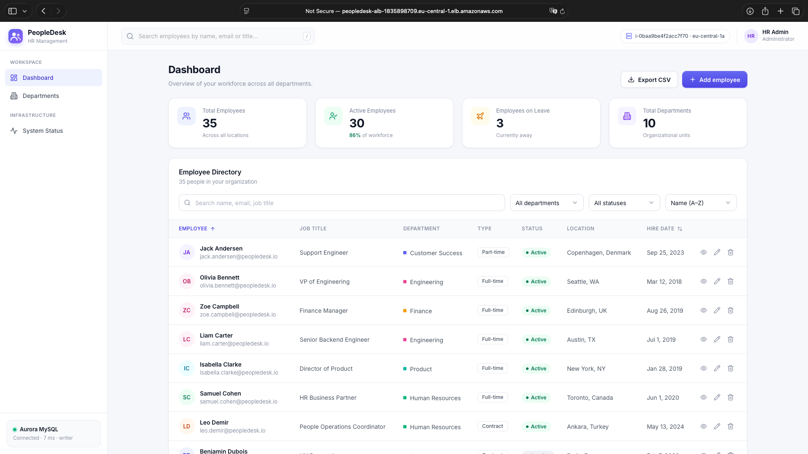 | 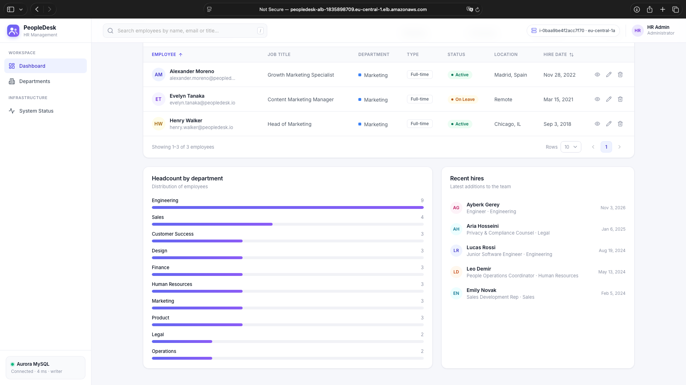 |

| Add employee | Departments |
| --- | --- |
| 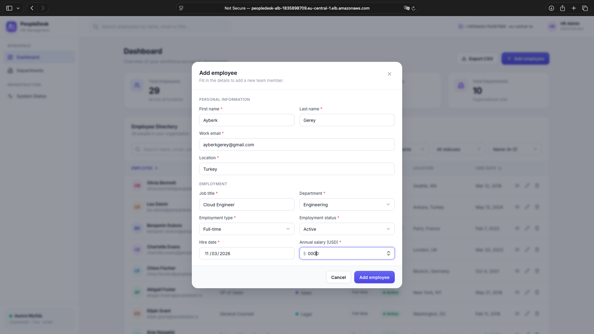 | 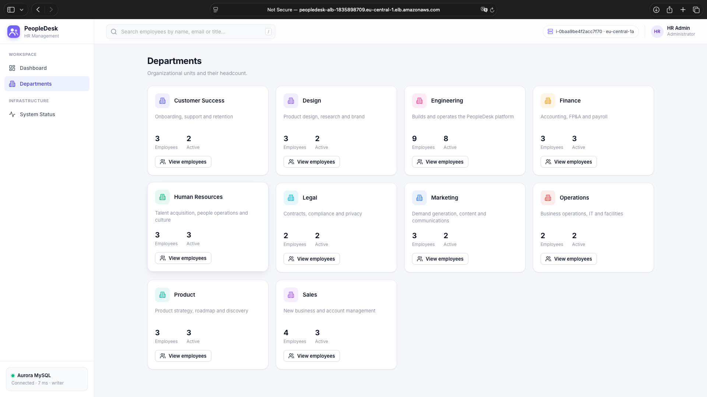 |

| System Status – instance, health checks and ALB distribution |
| --- |
| 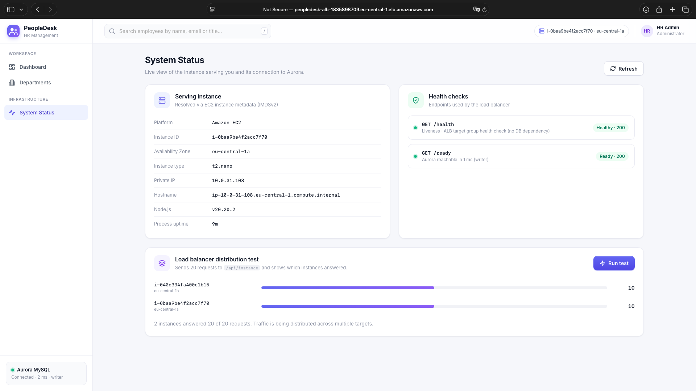 |

### AWS infrastructure

| VPC resource map | Subnets |
| --- | --- |
| 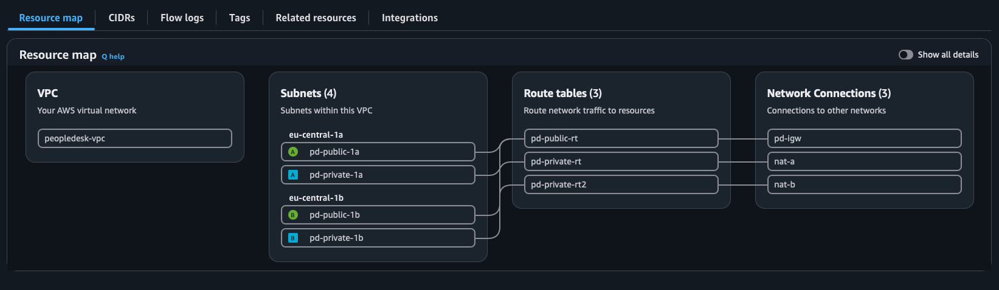 | 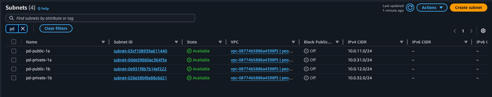 |

| NAT gateways | Security groups |
| --- | --- |
| 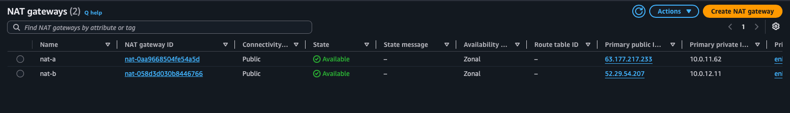 | 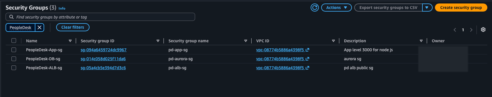 |

| ALB SG – 80 from internet | App SG – 3000 from ALB SG | Aurora SG – 3306 from app SG |
| --- | --- | --- |
| 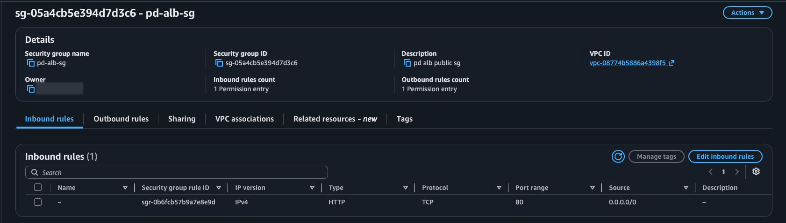 | 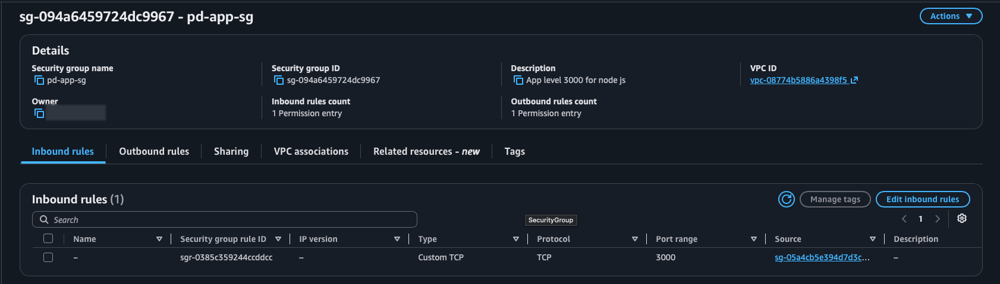 | 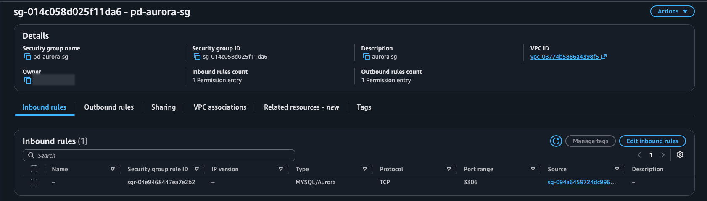 |

| Application Load Balancer | Target group health |
| --- | --- |
| 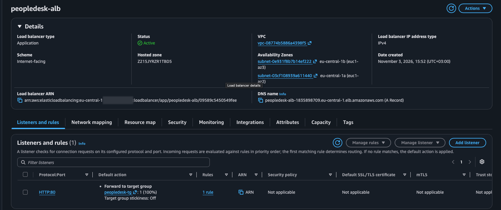 | 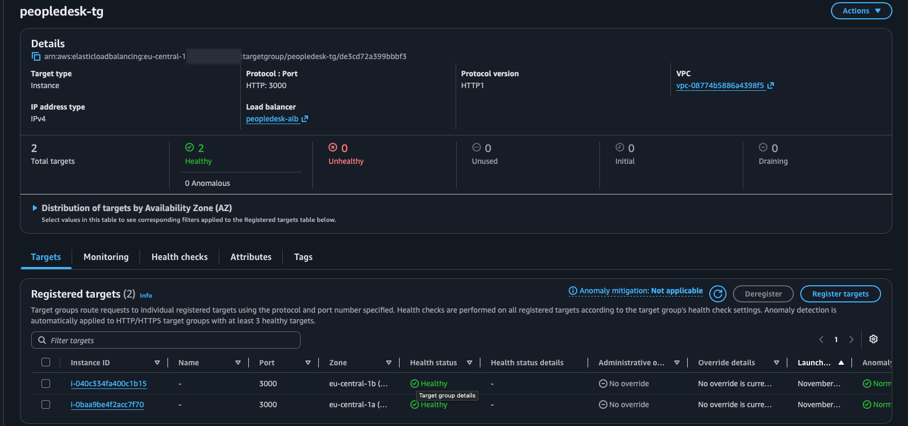 |

| EC2 instances | Aurora cluster |
| --- | --- |
| 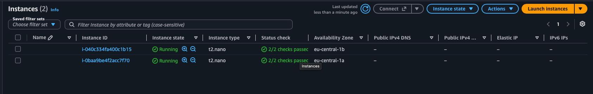 | 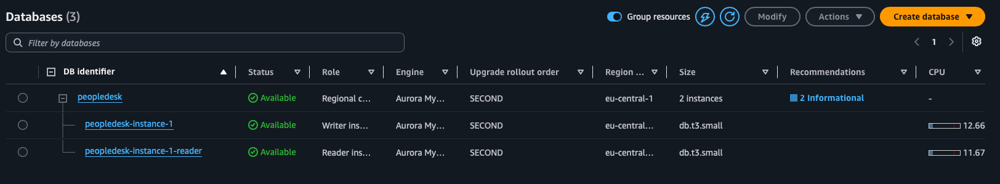 |

| IAM role | Secrets Manager |
| --- | --- |
| 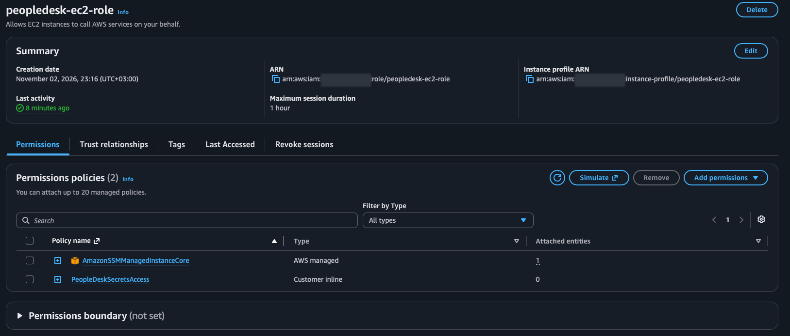 | 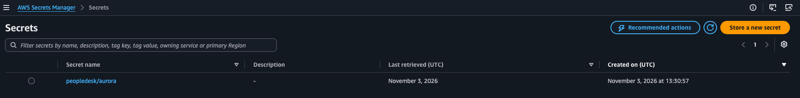 |

### Failover tests

| EC2 stopping | Target group during the failure |
| --- | --- |
|  |  |

| Served by the surviving AZ | Auto Scaling replacement |
| --- | --- |
|  |  |

| Aurora failover in progress – roles swapped | Application after failover |
| --- | --- |
| 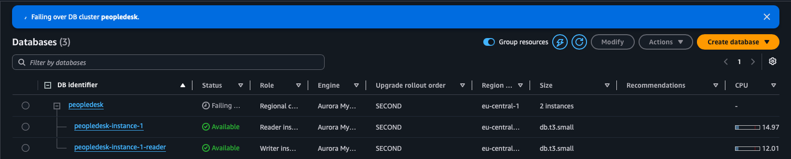 | 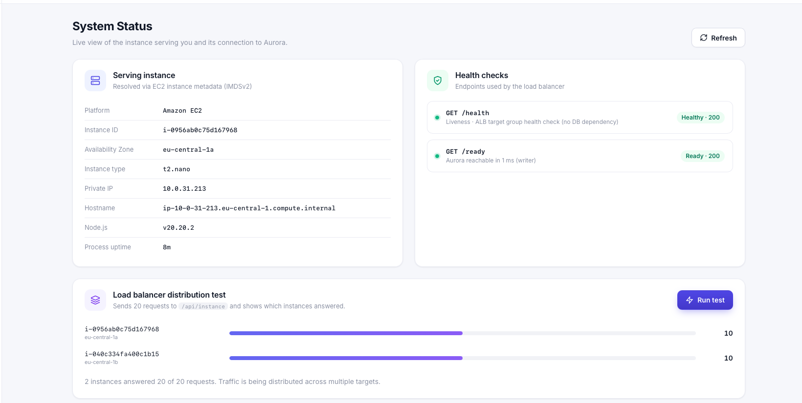 |

---

## J. Deployment and configuration

> Use placeholders for all identifiers. Never commit passwords, secret values, account IDs or `.env` files.

### Prerequisites

- An AWS account and access to the **eu-central-1** region.
- The network from [section D](#d-network-architecture): VPC, 4 subnets, Internet Gateway, 2 NAT gateways, 3 route tables and 3 security groups.
- This repository reachable from the instances. The user data clones it from GitHub through the NAT gateway.

### 1. Aurora MySQL cluster

1. Create a **DB subnet group** with `pd-private-1a` and `pd-private-1b`.
2. Create an Aurora MySQL cluster `peopledesk`:
   - in `peopledesk-vpc`, using that subnet group and `pd-aurora-sg`;
   - **public access disabled**;
   - with a **reader in a different AZ** from the writer.
3. Copy the **cluster (writer) endpoint** from *Connectivity & security*.

### 2. Secrets Manager

Create a secret named **`peopledesk/aurora`** (*Other type of secret*) with this JSON structure:

```json
{
  "username": "app_user",
  "password": "<strong-unique-password>",
  "host": "<cluster-writer-endpoint>",
  "port": 3306,
  "database": "employee_management"
}
```

### 3. IAM role

Create **`peopledesk-ec2-role`** (trusted entity: EC2) with:

- `AmazonSSMManagedInstanceCore`
- an inline policy allowing `secretsmanager:GetSecretValue` on the secret ARN ([section G](#g-security-design))

### 4. Launch template and Auto Scaling group

**Launch template:**

- Amazon Linux 2023 AMI
- the IAM instance profile above, and `pd-app-sg`
- no key pair
- IMDSv2 (token required)
- user data:

```bash
#!/bin/bash
set -euxo pipefail
dnf install -y git
git clone https://github.com/ayberkgerey/high-availability-em.git /opt/src/peopledesk
cd /opt/src/peopledesk
AWS_REGION=eu-central-1 AWS_SECRET_NAME=peopledesk/aurora ./deployment/install.sh
```

**Auto Scaling group:**

- subnets `pd-private-1a` and `pd-private-1b`
- attached to `peopledesk-tg`
- desired capacity **2**

### 5. Target group and load balancer

- **Target group `peopledesk-tg`:** instances, HTTP **3000**, health check path **`/health`**, stickiness **off**.
- **ALB `peopledesk-alb`:**
  - internet-facing, in `pd-public-1a` and `pd-public-1b`
  - security group `pd-alb-sg`
  - listener **HTTP:80 → peopledesk-tg**

### 6. What `install.sh` does

[`deployment/install.sh`](deployment/install.sh) is idempotent and runs as root:

1. Installs OS packages, the MariaDB client and **Node.js 20**.
2. Creates the non-login service user `nodeapp`.
3. Copies `backend/`, `frontend/` and `database/` to `/opt/employee-management` and runs `npm ci --omit=dev`.
4. Downloads the Amazon RDS CA bundle for TLS.
5. Detects the region from IMDSv2 if `AWS_REGION` is empty.
6. Writes `/etc/employee-management/app.env` (mode 0640). The file contains the secret **name**, not the credentials.
7. Installs and starts the `employee-management` systemd service.
8. Checks `/health` and `/ready`.

### 7. Database setup (one time)

Connect to one instance with **Session Manager** (EC2 → Connect → Session Manager), then:

```bash
# Load schema and sample data (prompts for the Aurora master password)
mysql -h <cluster-writer-endpoint> -u <master-user> -p < /opt/employee-management/database/schema.sql

# Create the least-privilege application user (password = value stored in the secret)
mysql -h <cluster-writer-endpoint> -u <master-user> -p
```

```sql
CREATE USER 'app_user'@'%' IDENTIFIED BY '<same-password-as-in-the-secret>';
GRANT SELECT, INSERT, UPDATE, DELETE ON employee_management.* TO 'app_user'@'%';
```

[`database/schema.sql`](database/schema.sql) is idempotent. It creates the database, both tables and their indexes, and loads 10 departments and 34 sample employees.

### 8. Managing the service

```bash
sudo systemctl status employee-management       # state
sudo systemctl restart employee-management      # restart after config changes
sudo journalctl -u employee-management -f       # structured JSON logs
sudo cat /etc/employee-management/app.env       # runtime configuration (no secrets)
```

### 9. Health verification on an instance

```bash
curl -s localhost:3000/health   # {"status":"ok",...}
curl -s localhost:3000/ready    # {"status":"ready","database":{"status":"connected","role":"writer",...}}
```

### Environment variables

| Variable | Purpose |
| --- | --- |
| `PORT` | Application port (default `3000`, must match the target group) |
| `AWS_REGION` / `AWS_SECRET_NAME` | Enables Secrets Manager mode |
| `DB_HOST`, `DB_PORT`, `DB_USER`, `DB_PASSWORD`, `DB_NAME` | Local mode, or fallbacks for fields missing from the secret |
| `DB_SSL`, `DB_SSL_CA_PATH` | TLS to Aurora |
| `DB_POOL_SIZE`, `DB_QUERY_RETRIES`, `DB_CONNECT_TIMEOUT_MS`, … | Pool and resilience tuning |

See [`.env.example`](.env.example) for the full list. EC2-specific notes are in [deployment/README-EC2.md](deployment/README-EC2.md).

### Local development

```bash
cp .env.example .env          # local values only, git-ignored
docker compose up -d          # MySQL 8 with schema and sample data
cd backend && npm install && npm run dev
# http://localhost:3000
```

---

## K. Testing

There is no automated test suite in this repository yet. Verification is done with the endpoints below, the UI, and the manual failover tests in [section H](#h-high-availability-and-failover-testing).

```bash
ALB=<alb-dns-name>            # e.g. from EC2 → Load Balancers → peopledesk-alb

# Application health (no DB dependency) and database readiness
curl -s http://$ALB/health
curl -s http://$ALB/ready

# Which instance / AZ answered
curl -s http://$ALB/api/instance

# Read operations
curl -s "http://$ALB/api/employees?search=engineer&pageSize=5"
curl -s http://$ALB/api/dashboard

# Create (returns 201 with the new id; a duplicate email returns 409)
curl -s -X POST http://$ALB/api/employees -H "Content-Type: application/json" -d '{
  "firstName": "Test", "lastName": "User", "email": "test.user@example.com",
  "jobTitle": "Cloud Engineer", "department": "Engineering",
  "employmentType": "Full-time", "status": "Active",
  "hireDate": "2026-11-03", "location": "Frankfurt, Germany", "salary": 75000
}'

# Update / delete
curl -s -X PUT    http://$ALB/api/employees/<id> -H "Content-Type: application/json" -d '{ ...full body... }'
curl -s -X DELETE http://$ALB/api/employees/<id> -o /dev/null -w "%{http_code}\n"   # 204
```

**Load-balancer distribution:**

```bash
for i in $(seq 1 20); do
  curl -s -D - -o /dev/null http://$ALB/health | grep -i x-served-by
done | sort | uniq -c
```

Each response carries an `X-Served-By: <instance-id> (<az>)` header. With two healthy targets, both instances should appear. The **System Status → Run test** button in the UI performs the same check against `/api/instance`.

**High-availability checks:**

- **Instance failure:** stop or terminate one instance while running the loop above, then follow [Test 1](#test-1--ec2-instance-failure-and-auto-scaling-recovery).
- **Database failover:** poll `/ready` once per second while running **Actions → Failover** on the cluster, then follow [Test 2](#test-2--aurora-database-failover).

---

## L. Cost considerations

This is a **portfolio / lab environment**. Exact prices depend on region, usage and the current AWS price list, so no monthly figures are given here. The main cost drivers are:

| Resource | What drives the cost | Notes |
| --- | --- | --- |
| **NAT Gateways (×2)** | Hourly charge per gateway plus per-GB data processing | Often the largest fixed cost in a small lab. They are charged **even when idle** and cannot be stopped, only deleted |
| **Aurora MySQL (×2 instances)** | Hourly charge per instance, plus storage and I/O, plus backup storage beyond the free allowance | A stopped cluster restarts automatically after 7 days. Storage is charged while the cluster exists. Older major versions can incur **Extended Support** charges |
| **Application Load Balancer** | Hourly charge plus Load Balancer Capacity Units (LCU) | Charged while it exists, even without traffic |
| **EC2 (×2, `t2.nano`)** | Hourly instance charge plus EBS volumes | Stopping an instance inside an Auto Scaling group triggers a replacement. Set the desired capacity to 0 instead |
| **Public IPv4 addresses** | Elastic IPs on the NAT gateways and the ALB's public IPs | Billed per hour, including unattached Elastic IPs |
| **Data transfer** | Internet egress, cross-AZ traffic between ALB, EC2 and Aurora, and NAT processing | Small for a lab, but it grows with traffic |
| **Secrets Manager** | Per secret per month plus API calls | Minor |

**Cleanup order** to stop all charges:

1. Delete the Auto Scaling group, which terminates its instances.
2. Delete the ALB, then the target group.
3. Delete the Aurora instances, reader first and then the writer, and then the cluster.
4. Delete the NAT gateways and **release their Elastic IPs**.
5. Delete the secret and the launch template.
6. Delete the VPC.

---

## M. Lessons learned

- **Multi-AZ means every layer, including the network.** Two app instances do not give HA if both private subnets route through a single NAT gateway. A per-AZ private route table pointing to a per-AZ NAT gateway was needed to remove that hidden single point of failure.
- **Health checks must match what the load balancer can fix.** Keeping `/health` independent of the database means a database failover does not make every target unhealthy at once. Database state is exposed separately through `/ready`.
- **Role is not identity in Aurora.** After the failover, the instance named `…-instance-1-reader` was the writer. Applications must use the **cluster writer endpoint**, and runbooks should not assume an instance's role from its name.
- **Failover is an application concern too.** Aurora handles promotion, but the client must discard dead or read-only connections, re-resolve DNS and retry safely. Reads can be retried; in-flight writes should not be replayed blindly.
- **Auto Scaling enforces desired state.** A manually stopped instance was terminated and replaced. This is good for self-healing, but it also means instances in an ASG cannot be "paused" to save cost; capacity must be changed on the group.
- **User data runs only on first boot.** When the instances first launched without a working outbound route, bootstrapping failed. The correct fix was to repair the network and let the ASG launch fresh instances, not to patch the old ones.
- **Some settings are fixed at creation.** An Aurora cluster cannot be moved to another VPC after creation. Checking the VPC, DB subnet group and security group before clicking *Create* saves a rebuild. Resolving the endpoint from an instance (`getent hosts`) and getting a `172.31.x.x` address quickly showed that the cluster had been created in the default VPC.
- **Security group rules belong to the receiving side.** The 3306 rule is on the database security group and references the app security group, not the other way round. Security-group references keep working when ASG instances change IPs.
- **IAM roles plus Secrets Manager remove a whole class of problems.** There are no keys to leak or rotate on servers. For troubleshooting, `/ready` combined with structured logs (`journalctl -u employee-management`) made it easy to tell network, IAM and credential errors apart.
- **Session Manager depends on outbound connectivity.** "Instance is not connected" errors came from missing NAT routes and still-initializing instances, not from security groups. No inbound port is needed.
- **Watch the defaults.** Console defaults, such as larger instance classes or older engine versions, have a direct cost impact. Every setting should be a conscious choice.

---

## N. Future improvements

These items are **not implemented** in the current deployment:

- **Infrastructure as Code** with Terraform (or AWS CDK) for the VPC, ALB, ASG, Aurora, IAM and secrets, so the environment can be reproduced and torn down with one command.
- **HTTPS** with an ACM certificate on the ALB, an HTTP → HTTPS redirect and HSTS.
- **AWS WAF** on the ALB with managed rule groups and rate limiting.
- **Amazon CloudWatch** monitoring:
  - CloudWatch agent for application logs;
  - alarms on ALB 5xx errors, unhealthy host count, Aurora CPU and connections, and NAT errors;
  - a dashboard.
- **Amazon RDS Proxy** for connection pooling, faster failover handling and IAM database authentication.
- **Read/write splitting:** route read-only queries to the Aurora reader endpoint.
- **CI/CD pipeline** (for example GitHub Actions) with automated tests, building versioned artifacts and rolling deployments through launch template versions or ASG instance refresh.
- **Automated testing:** unit and integration tests for services and validation, plus scripted failover tests that measure error rate and recovery time.
- **Scaling policies:** target tracking on CPU or ALB request count per target, with documented minimum and maximum capacity.
- **VPC interface endpoints** for Secrets Manager and SSM, so AWS API traffic stays off the NAT path.
- **Secret rotation** with a Secrets Manager rotation function.
- **Aurora MySQL 3 (MySQL 8.0)** if the cluster is on an older major version, together with a supported instance class.
- **Authentication and authorization** for the application, for example Amazon Cognito with role-based access.
- **Tighter egress rules** and a custom SSM policy instead of the broad managed policy.

---

## License

MIT. Free to use for learning and portfolios.
