# PeopleDesk – AWS Üzerinde Yüksek Erişilebilir Çalışan Yönetimi

[English](README.md) | **Türkçe**

> **eu-central-1 (Frankfurt)** bölgesinde **iki Availability Zone**'a dağıtılmış, durumsuz (stateless) bir Node.js çalışan yönetimi uygulaması. Uygulama bir **Application Load Balancer**'ın arkasında, private subnet'lerdeki bir **EC2 Auto Scaling group** üzerinde çalışır. Veri katmanı, writer ve reader instance'lardan oluşan bir **Amazon Aurora MySQL** cluster'ıdır. Veritabanı bilgileri **IAM instance role** üzerinden **AWS Secrets Manager**'dan okunur. Sunuculara yönetimsel erişim SSH yerine **Systems Manager Session Manager** ile sağlanır.


---

## İçindekiler

- [A. Projeye genel bakış](#a-projeye-genel-bakış)
- [B. Mimari diyagramı](#b-mimari-diyagramı)
- [C. Kullanılan AWS servisleri](#c-kullanılan-aws-servisleri)
- [D. Ağ mimarisi](#d-ağ-mimarisi)
- [E. Uygulama mimarisi](#e-uygulama-mimarisi)
- [F. Veritabanı mimarisi](#f-veritabanı-mimarisi)
- [G. Güvenlik tasarımı](#g-güvenlik-tasarımı)
- [H. Yüksek erişilebilirlik ve failover testleri](#h-yüksek-erişilebilirlik-ve-failover-testleri)
- [I. Ekran görüntüleri](#i-ekran-görüntüleri)
- [J. Kurulum ve yapılandırma](#j-kurulum-ve-yapılandırma)
- [K. Test](#k-test)
- [L. Maliyet değerlendirmesi](#l-maliyet-değerlendirmesi)
- [M. Öğrenilen dersler](#m-öğrenilen-dersler)
- [N. Gelecek geliştirmeler](#n-gelecek-geliştirmeler)

---

## A. Projeye genel bakış

**PeopleDesk**, çalışan ve departman yönetimi için geliştirilmiş bir İK web uygulamasıdır. İK ekibi çalışan rehberinde arama, filtreleme, sıralama ve sayfalama yapabilir. Çalışan kaydı ekleyebilir, görüntüleyebilir, düzenleyebilir ve silebilir; rehberi CSV olarak dışa aktarabilir. Dashboard'da departman bazında çalışan sayısı ve son işe alımlar gibi metrikleri görebilir. **System Status** sayfası, isteği hangi EC2 instance'ının ve hangi Availability Zone'un karşıladığını, anlık health ve readiness durumunu gösterir ve ALB üzerinden bir yük dağılımı testi sunar.

**Projenin amacı.** PeopleDesk'i uygulamalı bir AWS Solutions Architecture portfolyo projesi olarak geliştirdim. Uygulama bilinçli olarak sade tutuldu: Node.js ve vanilla JavaScript, build adımı yok. Odak noktası, uygulamanın etrafındaki altyapı ve multi-AZ bir dağıtımın pratikte çalışmasını sağlayan uygulama seviyesindeki kararlar.

**Mimari hedefler**

| Hedef | Nasıl karşılanıyor |
| --- | --- |
| **Yüksek erişilebilirlik** | ALB arkasında iki AZ'de uygulama instance'ları; Multi-AZ bir Aurora cluster'ında writer ve reader |
| **Hata toleransı** | Auto Scaling group bozulan instance'ları yeniler. Aurora reader'a failover eder, uygulama cluster writer endpoint üzerinden yeniden bağlanır |
| **Güvenlik** | Uygulama ve veritabanı için private subnet'ler, zincirleme security group'lar, IAM role ile Secrets Manager, SSH yok |
| **Ölçeklenebilirlik** | ALB arkasında durumsuz uygulama katmanı; instance'lar istenildiği an eklenip çıkarılabilir |
| **İşletilebilirlik** | Ayrı `/health` (liveness) ve `/ready` (veritabanı readiness) endpoint'leri, yapılandırılmış JSON loglar, systemd servisi, script ile kurulum |

---

## B. Mimari diyagramı

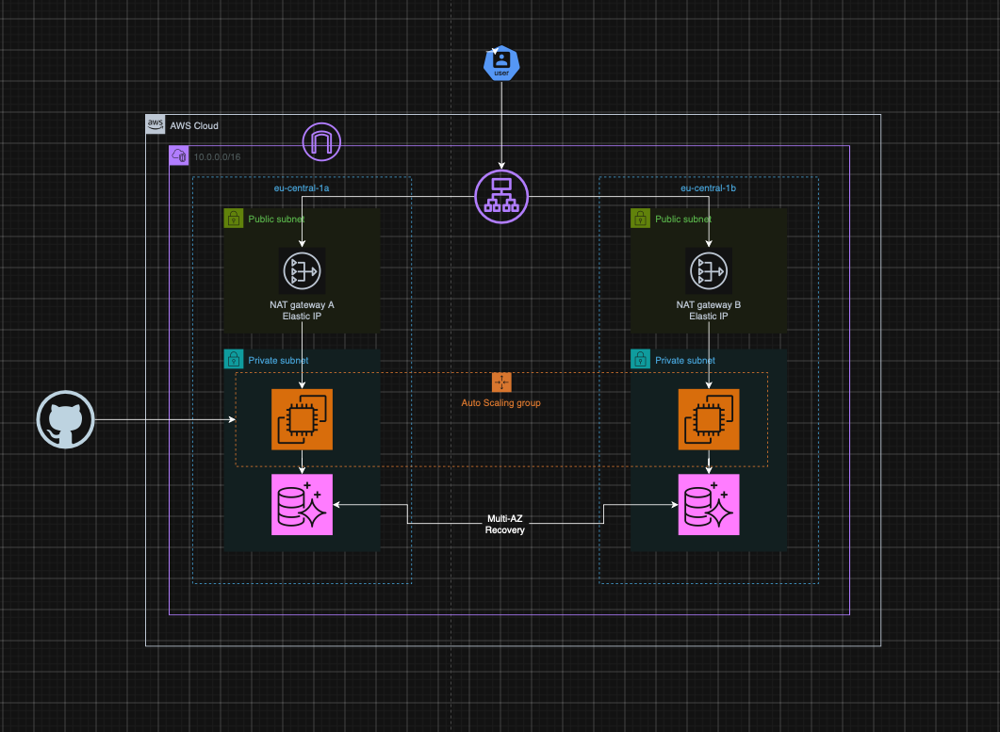

Aşağıdaki Mermaid diyagramı kaynak adlarını, portları, security group'ları ve bölgesel servisleri de gösterir:

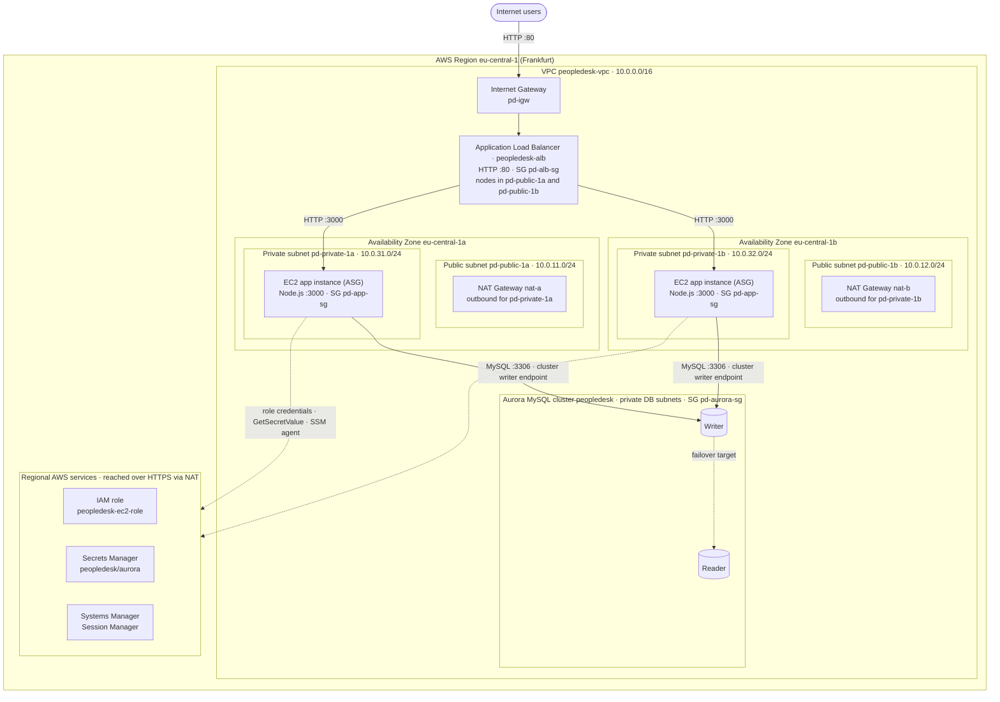

**Diyagrama dair notlar**

- İki EC2 instance'ı, `pd-private-1a` ve `pd-private-1b`'yi kapsayan tek bir **EC2 Auto Scaling group** tarafından yönetilir ve `peopledesk-tg` target group'una kayıtlıdır.
- Writer ve reader rolleri **belirli bir instance'a bağlı değildir**. Failover testinden sonra adı `peopledesk-instance-1-reader` olan instance writer oldu (bkz. [bölüm H](#h-yüksek-erişilebilirlik-ve-failover-testleri)).
- Instance'lardan Secrets Manager'a ve Systems Manager'a giden trafik, aynı AZ'deki NAT gateway üzerinden çıkar. VPC interface endpoint kullanılmıyor.

Daha ayrıntılı tasarım dokümanı: [docs/architecture.md](docs/architecture.md) (İngilizce).

---

## C. Kullanılan AWS servisleri

| AWS servisi | PeopleDesk'teki görevi | Neden seçildi |
| --- | --- | --- |
| **Amazon VPC** | İki AZ'de 2 public ve 2 private subnet içeren izole ağ `peopledesk-vpc` (10.0.0.0/16) | Routing ve ağ sınırları üzerinde tam kontrol sağlar. Public ve private subnet ayrımı güvenlik modelinin temelidir |
| **Internet Gateway** (`pd-igw`) | Public subnet'lerin internet bağlantısı | Internet-facing ALB ve NAT gateway'lerin dışarı çıkışı için gerekli |
| **NAT Gateway** (`nat-a`, `nat-b`) | Private instance'lara yalnızca dışarı yönlü internet erişimi (paket kurulumu, GitHub clone, AWS API'leri) | Instance'lara internetten erişilemez. Her AZ'de bir zonal NAT, tek bir NAT'a bağımlılığı ortadan kaldırır |
| **Application Load Balancer** (`peopledesk-alb`) | HTTP :80 üzerinde tek public giriş noktası; trafiği 3000 portunda `peopledesk-tg`'ye iletir | AZ'ler arası Katman 7 yük dengeleme, yerleşik health check ve sağlıksız target'ların otomatik devreden çıkarılması. Uygulama durumsuz olduğu için stickiness kapalı |
| **Amazon EC2** | Node.js/Express uygulamasını çalıştırır (Amazon Linux 2023, bu lab'da `t2.nano`) | İşletim sistemi, systemd ve ağ dahil tüm katmanları gösteren, sade ve şeffaf bir compute katmanı |
| **EC2 Auto Scaling** | İki private subnet'te istenen sayıda uygulama instance'ını ayakta tutar | Kendi kendini onarma: durdurulan ya da bozulan instance, testte görüldüğü gibi otomatik olarak yenilenir |
| **Amazon Aurora MySQL** | Writer ve reader instance'lı `peopledesk` cluster'ı (`db.t3.small`) | Depolaması AZ'ler arasında replike edilen, reader'a otomatik failover yapan yönetilen MySQL uyumlu veritabanı |
| **AWS Secrets Manager** | Uygulamanın veritabanı bilgilerini ve endpoint'ini `peopledesk/aurora` secret'ında saklar | Şifreler kodda, AMI'de, user data'da ve Git'te bulunmaz. Erişim IAM ile kontrol edilir ve denetlenir |
| **AWS IAM** | Instance profile ile instance'lara bağlanan `peopledesk-ec2-role` | AWS SDK'ya geçici ve otomatik yenilenen kimlik bilgileri sağlar. Sunucularda access key yok |
| **AWS Systems Manager – Session Manager** | Private instance'lara shell erişimi | Bastion host yok, SSH anahtarı yok, 22 portu açık değil. Erişim IAM ile yönetilir |
| **Security Groups** | ALB, uygulama ve veritabanı katmanları için stateful güvenlik duvarları | Security group referanslarıyla zincirlenmiştir: her katman yalnızca önündeki katmandan trafik kabul eder |

---

## D. Ağ mimarisi

### VPC ve subnet tasarımı

| Subnet | AZ | CIDR | Route table | Varsayılan rota | İçerdiği kaynaklar |
| --- | --- | --- | --- | --- | --- |
| `pd-public-1a` | eu-central-1a | 10.0.11.0/24 | `pd-public-rt` | `0.0.0.0/0 → pd-igw` | ALB node, NAT gateway `nat-a` |
| `pd-public-1b` | eu-central-1b | 10.0.12.0/24 | `pd-public-rt` | `0.0.0.0/0 → pd-igw` | ALB node, NAT gateway `nat-b` |
| `pd-private-1a` | eu-central-1a | 10.0.31.0/24 | `pd-private-rt` | `0.0.0.0/0 → nat-a` | EC2 uygulama instance'ı, Aurora instance'ı (DB subnet group ile) |
| `pd-private-1b` | eu-central-1b | 10.0.32.0/24 | `pd-private-rt2` | `0.0.0.0/0 → nat-b` | EC2 uygulama instance'ı, Aurora instance'ı (DB subnet group ile) |

Tüm route table'larda ayrıca örtük `10.0.0.0/16 → local` rotası bulunur.

### Public ve private subnet sorumlulukları

- **Public subnet'lerde** yalnızca internete dönük altyapı bulunur: ALB ve NAT gateway'ler. Burada uygulama sunucusu ya da veritabanı çalışmaz.
- **Private subnet'lerde** EC2 uygulama instance'ları ve Aurora instance'ları bulunur. Bunların public IP adresi yoktur ve internetten bu subnet'lere bir rota yoktur.

### Internet Gateway, NAT Gateway'ler ve route table'lar

- İki public subnet de aynı bölgesel Internet Gateway'i kullandığı için **tek bir public route table** yeterlidir.
- **Her private subnet'in kendi route table'ı vardır** ve bu tablo **kendi AZ'sindeki** NAT gateway'e yönlendirir. Bir route table'da `0.0.0.0/0` için yalnızca tek bir hedef olabilir. Ortak tek bir private route table kullanılsaydı iki AZ de tek bir NAT'a bağımlı olurdu; o AZ kaybedildiğinde sağlıklı AZ'nin dışarı çıkışı da kesilirdi.
- NAT gateway'ler **zonal**'dır ve her birinin bir Elastic IP'si vardır.

### Trafik akışı

1. **Gelen istek:** Kullanıcı → Internet Gateway → ALB (`pd-alb-sg`, HTTP :80) → `peopledesk-tg` içindeki sağlıklı target'lardan biri (HTTP :3000, `pd-app-sg`).
2. **Veritabanı erişimi:** EC2 → TCP 3306 üzerinden Aurora **cluster writer endpoint** (`pd-aurora-sg`), VPC içinde.
3. **Instance'lardan dışarı çıkış:** EC2 → aynı AZ'deki NAT gateway → Internet Gateway. Bu yol şunlar için kullanılır:
   - açılışta paket kurulumu ve repository'nin klonlanması (user data);
   - Secrets Manager API çağrıları;
   - SSM agent kaydı.
4. **Dönüş trafiğine** security group'lar stateful olduğu için otomatik olarak izin verilir.

### Security group kuralları

| Security group | Inbound kural | Kaynak | Amaç |
| --- | --- | --- | --- |
| `pd-alb-sg` | HTTP TCP 80 | `0.0.0.0/0` | ALB'ye gelen public web trafiği |
| `pd-app-sg` | TCP 3000 | `pd-alb-sg` (security group referansı) | Uygulama portuna yalnızca ALB erişebilir |
| `pd-aurora-sg` | MySQL/Aurora TCP 3306 | `pd-app-sg` (security group referansı) | Veritabanına yalnızca uygulama instance'ları erişebilir |

Kurallar **IP aralıkları yerine security group ID'lerine** referans verir. Böylece Auto Scaling group instance'ları yenileyip private IP'ler değiştiğinde de kurallar geçerli kalır.

---

## E. Uygulama mimarisi

### Genel yapı

Her instance'ta tek bir Node.js process'i hem statik frontend'i hem de REST API'yi 3000 portundan sunar. Sunucu tarafında oturum durumu tutulmaz: her istek herhangi bir instance tarafından karşılanabilir. Sticky session olmadan round-robin yük dengelemeyi mümkün kılan da budur.

| Katman | Teknoloji | Konum |
| --- | --- | --- |
| Frontend | HTML5, CSS3, vanilla JavaScript (Fetch API, hash routing), build adımı yok | [`frontend/`](frontend) |
| Backend | Node.js 20, Express 4, Helmet, compression | [`backend/`](backend) |
| Veritabanı sürücüsü | `mysql2/promise` connection pool | [`backend/src/db/pool.js`](backend/src/db/pool.js) |
| AWS SDK | AWS SDK for JavaScript v3 (`@aws-sdk/client-secrets-manager`) | [`backend/src/config/secrets.js`](backend/src/config/secrets.js) |
| Process yönetimi | Otomatik yeniden başlatma ve sandboxing içeren systemd unit | [`deployment/employee-management.service`](deployment/employee-management.service) |

### Backend yapısı

```
backend/
├── server.js                 HTTP sunucusu, keep-alive ayarları, graceful shutdown, DB warm-up
└── src/
    ├── app.js                Middleware zinciri: request context → health → güvenlik başlıkları → /api → statik dosyalar
    ├── config/               Ortam yapılandırması + Secrets Manager okuyucusu
    ├── routes/               URL → controller eşlemesi
    ├── controllers/          HTTP sorumlulukları (durum kodları, CSV export)
    ├── validation/           Girdi doğrulama ve normalizasyon
    ├── services/             İş mantığı ve parametreli SQL
    ├── db/pool.js            Connection pool, retry, failover yönetimi, kimlik bilgisi yenileme
    ├── middleware/           Request ID / access log, async handler, merkezi hata yönetimi
    └── utils/                JSON logger, hata sınıfları
```

Frontend yalnızca **göreli URL'ler** (`/api/...`) kullanır. Bu sayede herhangi bir ALB DNS adının arkasında ek yapılandırma olmadan çalışır.

### REST API

| Metot | Yol | Açıklama |
| --- | --- | --- |
| GET | `/health` | Liveness. Process çalıştığı sürece 200 döner. **ALB target group health check'i bunu kullanır.** Veritabanına bağımlı değildir |
| GET | `/ready` | Readiness. Aurora'ya erişilebiliyorsa 200 ile birlikte DB rolünü (`writer` / `reader`) döner, aksi halde 503 |
| GET | `/api/dashboard` | Toplamlar, departman bazında çalışan sayısı, son işe alımlar |
| GET | `/api/employees` | `search`, `department`, `status`, `sortBy`, `sortOrder`, `page`, `pageSize` parametreleriyle liste |
| GET | `/api/employees/export` | Aynı filtrelerle CSV export |
| GET | `/api/employees/:id` | Tek çalışan |
| POST | `/api/employees` | Çalışan oluşturma |
| PUT | `/api/employees/:id` | Çalışan güncelleme |
| DELETE | `/api/employees/:id` | Çalışan silme |
| GET | `/api/departments` | Çalışan sayılarıyla departmanlar |
| GET | `/api/instance` | İsteği karşılayan instance ID, AZ ve instance tipi (IMDSv2 ile) |

İstek ve yanıt örnekleri, doğrulama kuralları ve hata kodları: [docs/api-documentation.md](docs/api-documentation.md).

### Health ve readiness ayrımı

İki endpoint bilinçli olarak farklı şeyleri kontrol eder:

- **`/health` ALB health check'idir** ve veritabanına dokunmaz ([`healthController.js`](backend/src/controllers/healthController.js)). Aurora'ya bağlı olsaydı, kısa bir veritabanı failover'ı *bütün* instance'ların health check'ini aynı anda düşürürdü ve ALB'de sağlıklı target kalmazdı. Kısa bir veritabanı kesintisi tam bir kesintiye dönüşürdü.
- **`/ready`** cluster'a `SELECT 1, @@innodb_read_only` sorgusu gönderir. Veritabanına erişilip erişilemediğini ve bağlantının bir writer'a gidip gitmediğini gösterir. Doğrulama ve sorun giderme için kullanılır.

### Veritabanı bilgilerinin alınması

1. Kurulum scripti `/etc/employee-management/app.env` dosyasına `AWS_SECRET_NAME=peopledesk/aurora` ve `AWS_REGION` değerlerini yazar. Bu dosyada şifre bulunmaz.
2. Uygulama açılırken [`secrets.js`](backend/src/config/secrets.js), AWS SDK v3 ile `GetSecretValue` çağrısı yapar. SDK'nın varsayılan kimlik bilgisi zinciri, geçici kimlik bilgilerini IMDS üzerinden **EC2 instance profile**'ından alır.
3. Secret'taki JSON (`username`, `password`, `host`, `port`, `database`) ile `mysql2` pool'u oluşturulur. Secret'ta olmayan alanlar `DB_*` ortam değişkenlerinden alınır.
4. Aurora kimlik bilgilerini reddederse (`ER_ACCESS_DENIED_ERROR`, örneğin bir şifre rotasyonundan sonra), pool secret'ı yeniden okur (en fazla 30 saniyede bir) ve kendini yeniden kurar.

AWS olmadan yerel geliştirmede `AWS_SECRET_NAME` boş bırakılır ve uygulama `DB_*` değerlerini git'e eklenmeyen bir `.env` dosyasından okur.

---

## F. Veritabanı mimarisi

### Aurora cluster

| Öğe | Değer |
| --- | --- |
| Cluster adı | `peopledesk` |
| Instance'lar | `peopledesk-instance-1`, `peopledesk-instance-1-reader` |
| Instance sınıfı | `db.t3.small` |
| Engine | Aurora MySQL (MySQL uyumlu). Şema Aurora MySQL 2.x (MySQL 5.7) ve 3.x (MySQL 8.0) ile uyumludur. Kesin engine sürümü: *dokümante edilecek* |
| Subnet'ler | `pd-private-1a` ve `pd-private-1b`'yi kapsayan DB subnet group |
| Ağ erişimi | Public erişime kapalı; `pd-aurora-sg` 3306'ya yalnızca `pd-app-sg`'den izin verir |
| Veritabanı / tablolar | `departments` ve `employees` tablolarını içeren `employee_management` ([`database/schema.sql`](database/schema.sql)) |

### Writer ve reader rolleri

- **Writer**, PeopleDesk'ten gelen tüm okuma ve yazma işlemlerini karşılar.
- **Reader**, aynı cluster volume'ünün güncel bir görünümünü tutar ve **failover hedefidir**. Aurora depolaması cluster'daki tüm instance'lar tarafından paylaşıldığı için reader'ın writer'a yükseltilmesi veri kopyalamayı gerektirmez.
- PeopleDesk şu anda **tüm trafiği writer'a** gönderir. Salt okunur sorguların reader endpoint'e yönlendirilmesi gelecek geliştirmeler arasındadır.

### Writer endpoint, reader endpoint ve instance endpoint'leri

| Endpoint | Biçim | Neyi gösterir | PeopleDesk kullanıyor mu |
| --- | --- | --- | --- |
| Cluster (writer) endpoint | `peopledesk.cluster-xxxx.eu-central-1.rds.amazonaws.com` | **O anki** writer | **Evet** (secret'ın `host` alanında) |
| Reader endpoint | `peopledesk.cluster-ro-xxxx.eu-central-1.rds.amazonaws.com` | Reader instance'(lar)ı | Hayır |
| Instance endpoint | `peopledesk-instance-1.xxxx.eu-central-1.rds.amazonaws.com` | Rolü ne olursa olsun belirli bir instance | Hayır |

**Neden cluster writer endpoint:** Instance endpoint bir role değil, fiziksel bir instance'a bağlıdır. Failover testinde `peopledesk-instance-1` writer'dan reader'a dönüştü. Bu instance'ın endpoint'ine bağlı bir uygulama, yazma işlemlerini artık salt okunur olan bir instance'a göndermeye devam ederdi. Cluster endpoint ise Aurora'nın failover sırasında yeni writer'a güncellediği bir DNS adıdır; uygulama yapılandırması hiç değişmez.

### Failover'ın uygulamaya etkisi

Failover sırasında eski writer'a açık bağlantılar kopar ya da artık salt okunur olan bir instance'a ulaşır. [`pool.js`](backend/src/db/pool.js) bu durumu şöyle ele alır:

- **Kopmuş ya da salt okunur bağlantılar yok edilir.** Fatal hatalar ve `ER_OPTION_PREVENTS_STATEMENT` hatası veren bağlantılar pool'a geri verilmez. Yeni bağlantılar cluster endpoint'ini yeniden çözümler ve yeni writer'a ulaşır.
- **Exponential backoff ile retry** yapılır (varsayılan 3 deneme, 250 ms'den başlayarak):
  - Bağlantı aşamasındaki hatalar her sorgu için tekrar denenir.
  - Sorgunun ortasında oluşan hatalar **yalnızca idempotent okumalar için** tekrar denenir. Bağlantısı kopan bir yazma işlemi commit edilmiş olabileceğinden körü körüne tekrarlanmaz.
- **Denemeler tükenirse** API `Retry-After: 5` başlığıyla `503 DATABASE_UNAVAILABLE` döner ve arayüz bir tekrar deneme mesajı gösterir. `/health` 200 dönmeye devam ettiği için ALB tüm instance'ları serviste tutar.
- **Yeniden başlatma gerekmez.** Yeni writer hazır olduğunda pool otomatik olarak yeniden bağlanır.

---

## G. Güvenlik tasarımı

### Ağ izolasyonu

- Uygulama instance'ları ve Aurora, public IP adresi olmayan **private subnet'lerde** çalışır.
- İnternete açık tek bileşen ALB'dir ve yalnızca HTTP :80'i dışarı açar.
- Security group'lar bir zincir oluşturur: **internet → `pd-alb-sg` (80) → `pd-app-sg` (3000) → `pd-aurora-sg` (3306)**.

### EC2'ye bağlı IAM role

`peopledesk-ec2-role` role'ünde iki policy bulunur:

| Policy | Tür | Amaç |
| --- | --- | --- |
| `AmazonSSMManagedInstanceCore` | AWS managed | SSM agent'ın instance'ı Session Manager için kaydetmesini sağlar |
| `PeopleDeskSecretsAccess` | Customer inline | PeopleDesk secret'ı için `secretsmanager:GetSecretValue` izni verir |

Inline policy'nin hedeflenen kapsamı (hesap numarası gizlenmiştir):

```json
{
  "Version": "2012-10-17",
  "Statement": [
    {
      "Effect": "Allow",
      "Action": "secretsmanager:GetSecretValue",
      "Resource": "arn:aws:secretsmanager:eu-central-1:<account-id>:secret:peopledesk/aurora-*"
    }
  ]
}
```

### Secrets Manager entegrasyonu ve sabit kodlanmış şifre olmaması

- Repository'de **hiçbir kimlik bilgisi yoktur**. `.env` ve `*.pem` dosyaları [`.gitignore`](.gitignore) ile hariç tutulur; yalnızca örnek değerler içeren `.env.example` commit edilir.
- EC2 user data'sı ve `/etc/employee-management/app.env` yalnızca **secret adını** ve bölgeyi içerir. Şifre Secrets Manager'da durur.
- Uygulama AWS'ye **geçici role kimlik bilgileriyle** erişir. Instance'larda access key yoktur.
- Veritabanı kullanıcısı `app_user`'ın `employee_management.*` üzerinde yalnızca `SELECT, INSERT, UPDATE, DELETE` yetkisi vardır. Aurora master kullanıcısı yalnızca tek seferlik şema kurulumunda kullanılır.
- Aurora bağlantıları, kurulum scriptinin indirdiği Amazon RDS CA bundle ile **TLS** kullanır (`DB_SSL=true`).

### SSH yerine Session Manager

- Instance'lara key pair atanmamıştır ve **hiçbir security group 22 portuna izin vermez**.
- Shell erişimi Session Manager ile yapılır. SSM agent NAT gateway üzerinden **dışarı yönlü** bir bağlantı açtığı için inbound kural gerekmez; erişim IAM ile yönetilir.

### Uygulama ve sunucu sıkılaştırma

- **HTTP:** Helmet güvenlik başlıkları, Content Security Policy (`script-src 'self'`) ve 50 KB JSON gövde limiti.
- **Girdi ve SQL:** sıkı sunucu tarafı doğrulama ve whitelist'li `ORDER BY` ile parametreli SQL. CSV export, formula injection'a karşı korunur.
- **Sunucu:** servis, oturum açamayan özel bir `nodeapp` kullanıcısıyla, systemd sandboxing (`ProtectSystem=strict`, `NoNewPrivileges`, `PrivateTmp`) altında çalışır. `app.env` yalnızca `root:nodeapp` tarafından okunabilir (0640).

### En az yetki: daha da kısıtlanması gerekenler

| Alan | Mevcut durum | Önerilen sıkılaştırma |
| --- | --- | --- |
| Inline secret policy | PeopleDesk secret'ı için `GetSecretValue` izni | `Resource` alanının tam olarak bu secret'ın ARN'si olduğu doğrulanmalı (wildcard secret olmamalı). Customer-managed KMS key kullanılırsa yalnızca o key ile sınırlı `kms:Decrypt` eklenmeli |
| `AmazonSSMManagedInstanceCore` | Geniş kapsamlı AWS managed policy | Lab için kabul edilebilir. Production'da yalnızca kullanılan Session Manager aksiyonlarını içeren özel bir policy düşünülmeli |
| Security group egress | Varsayılan "tüm trafik" outbound kuralı | `pd-app-sg` çıkışı 443 (AWS API'leri, paketler) ve `pd-aurora-sg`'ye 3306 ile sınırlandırılmalı |
| Kullanıcıya giden trafik | ALB'de yalnızca HTTP | ACM sertifikalı bir HTTPS listener eklenmeli ve 80 → 443 yönlendirmesi yapılmalı |
| ALB'nin internete açıklığı | 80 portunda `0.0.0.0/0` | AWS WAF managed kuralları ve rate limiting eklenmeli |
| Kimlik doğrulama | Uygulamada **kullanıcı kimlik doğrulaması yok** | Gerçek İK verisiyle çalışmadan önce bir kimlik katmanı (örneğin Amazon Cognito) eklenmeli |
| Veritabanı kimlik bilgileri | Sabit `app_user` şifresi | Secrets Manager rotasyonu açılmalı. Uygulama kimlik doğrulama hatasından sonra bilgileri zaten yeniden okuyor |

---

## H. Yüksek erişilebilirlik ve failover testleri

Çalışan ortamda iki arıza senaryosu manuel olarak test edildi. Her testte **ekran görüntülerinde gözlemlenen** sonuçlar, yalnızca **beklenen** davranışlardan ayrı olarak listelenmiştir.

### Test 1 – EC2 instance arızası ve Auto Scaling ile kurtarma

| | |
| --- | --- |
| **Amaç** | ALB'nin arızalı instance'a trafik göndermeyi bıraktığını, uygulamanın kalan AZ üzerinden erişilebilir kaldığını ve Auto Scaling group'un istenen kapasiteyi geri getirdiğini doğrulamak |
| **Başlangıç durumu** | `i-0baa9be4f2acc7f70` (eu-central-1a) ve `i-040c334fa400c1b15` (eu-central-1b) target'larının ikisi de `peopledesk-tg`'de **healthy** idi. System Status dağılım testi 20 isteği iki instance'a 10/10 böldü ([tg.png](screenshots/aws_console_screenshots/tg.png), [system_status.png](screenshots/project_screenshots/system_status.png)) |
| **Prosedür** | 1. eu-central-1a'daki `i-0baa9be4f2acc7f70` instance'ını EC2 konsolundan durdur.<br/>2. Target group'u izle.<br/>3. PeopleDesk'i ALB DNS adı üzerinden aç.<br/>4. Auto Scaling aktivitesini EC2 instance listesinden izle |
| **Beklenen sonuç** | Durdurulan target servis dışı kalır ve ALB tüm trafiği sağlıklı instance'a gönderir. Auto Scaling group sağlıksız instance'ı tespit eder, sonlandırır ve yerine yenisini başlatır. Yeni instance `/health` kontrolünü geçip trafik almaya başlar |

**Gözlemlenen sonuç**

1. Instance **Stopping** durumuna geçti ([test_ss_1](screenshots/ec2_failover_test%28alb%26asg%29/test_ss_1.png)).
2. `peopledesk-tg`'de **1 healthy** target kaldı (`i-040c334fa400c1b15`, eu-central-1b). Durdurulan target *"Target is in the stopped state"* olarak raporlandı ve yönlendirmeden çıkarıldı ([test_ss_2](screenshots/ec2_failover_test%28alb%26asg%29/test_ss_2.png)).
3. PeopleDesk ALB üzerinden erişilebilir kaldı. İstekleri eu-central-1b'deki `i-040c334fa400c1b15` karşıladı; `/health` 200 ve `/ready` 200 döndü ([test_ss_3](screenshots/ec2_failover_test%28alb%26asg%29/test_ss_3.png)).
4. Auto Scaling group durdurulan instance'ı **sonlandırdı** ve eu-central-1a'da **yeni bir instance** başlattı: `i-0956ab0c75d167968` ([test_ss_4](screenshots/ec2_failover_test%28alb%26asg%29/test_ss_4.png)).
5. Daha sonra yapılan dağılım testinde 20 isteğin 20'si yeni instance `i-0956ab0c75d167968` (1a) ile `i-040c334fa400c1b15` (1b) arasında 10/10 bölündü. Yeni instance target group'a katılmış ve trafik alıyordu ([aurora_failover_2](screenshots/aurora_failover_test/aurora_failover_2.png)).

**Ölçülmeyenler:** yenilemenin tam süresi ve geçiş sırasında tek tek isteklerin başarısız olup olmadığı. Test sırasında sürekli bir yük testi çalışmıyordu.

### Test 2 – Aurora veritabanı failover testi

| | |
| --- | --- |
| **Amaç** | Writer'dan reader'a rol değişiminin uygulama yapılandırması değişmeden gerçekleştiğini ve uygulamanın yeni writer'a yeniden bağlandığını doğrulamak |
| **Başlangıç durumu** | `peopledesk-instance-1` = **Writer**, `peopledesk-instance-1-reader` = **Reader**; ikisi de `db.t3.small` ve Available ([rds.png](screenshots/aws_console_screenshots/rds.png)) |
| **Prosedür** | RDS konsolundan manuel failover başlat: `peopledesk` cluster → **Actions → Failover** |
| **Beklenen sonuç** | Aurora reader'ı writer'a yükseltir ve cluster writer endpoint DNS kaydını günceller. Eski writer'a giden bağlantılar başarısız olur ve pool tarafından atılır; yeni bağlantılar yeni writer'a gider. Kısa bir süre `503 DATABASE_UNAVAILABLE` yanıtları görülebilir |

**Gözlemlenen sonuç**

1. Konsolda *"Failing over DB cluster peopledesk"* mesajı göründü ve cluster durumu **Failing over** oldu ([aurora_failover_1](screenshots/aurora_failover_test/aurora_failover_1.png)).
2. Roller **yer değiştirdi**: `peopledesk-instance-1` **Reader**, `peopledesk-instance-1-reader` **Writer** oldu. Instance adları aynı kaldı. Bu, uygulamanın neden instance adlarına ya da instance endpoint'lerine bağlı olmaması gerektiğini gösteriyor.
3. Uygulama yapılandırması **değiştirilmedi**. Secret hâlâ cluster writer endpoint'ini gösteriyor.

### Test 3 – Aurora failover sonrası uygulamanın toparlanması

| | |
| --- | --- |
| **Amaç** | Failover'dan sonra PeopleDesk'in, servis yeniden başlatılmadan, veritabanına dayalı sayfaları yeniden sunduğunu doğrulamak |
| **Prosedür** | Failover'dan sonra PeopleDesk'i ALB üzerinden açıp System Status sayfasını kontrol et |
| **Beklenen sonuç** | `/ready` `writer` rolüyle 200 döner ve iki instance da isteklere yanıt verir |

**Gözlemlenen sonuç**

- Failover'dan sonra PeopleDesk'e ALB üzerinden erişilebildi. System Status sayfasında `GET /health` → **Healthy · 200** ve `GET /ready` → **Ready · 200**, *"Aurora reachable in 1 ms (writer)"* görüldü ([aurora_failover_2](screenshots/aurora_failover_test/aurora_failover_2.png)).
- Yük dağılımı testine iki instance da 10/10 yanıt verdi.
- **Doğrulanmayan:** failover süresince veritabanı işlemlerinin kesintisiz devam edip etmediği. Failover sırasında yapılan istekler kaydedilmedi; bu nedenle bu README sıfır kesinti iddiasında bulunmaz. Tasarım, kısa bir süre 503 yanıtı ve ardından otomatik toparlanma bekler.

---

## I. Ekran görüntüleri

### Uygulama

| Dashboard | Dashboard – grafikler ve son işe alımlar |
| --- | --- |
| 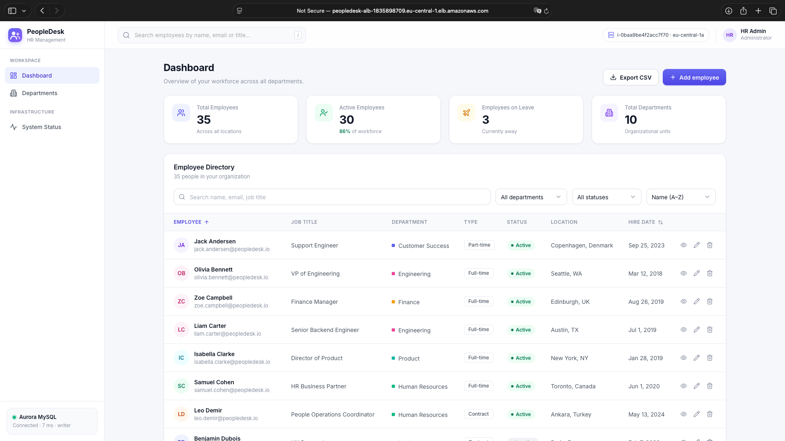 | 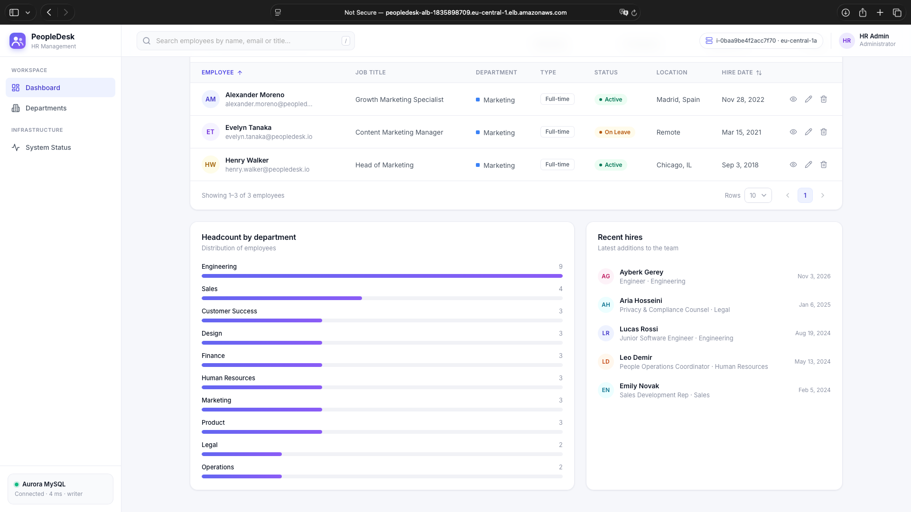 |

| Çalışan ekleme | Departmanlar |
| --- | --- |
| 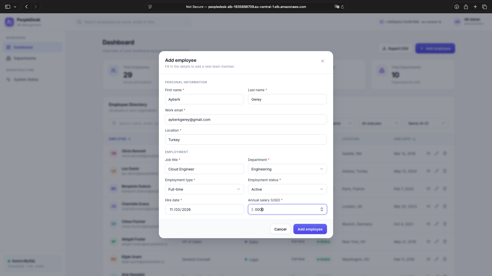 | 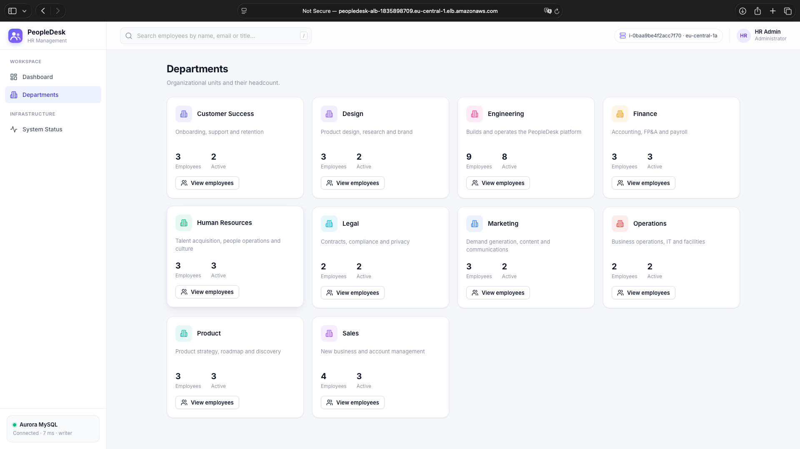 |

| System Status – instance, health check'ler ve ALB dağılımı |
| --- |
| 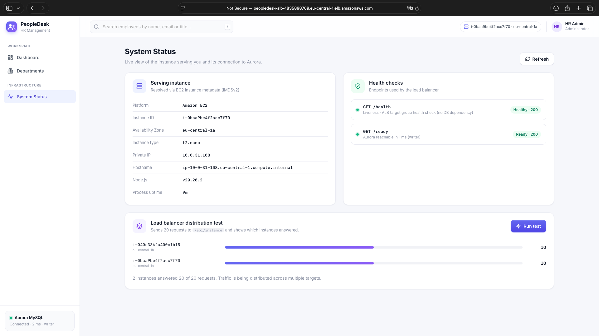 |

### AWS altyapısı

| VPC resource map | Subnet'ler |
| --- | --- |
| 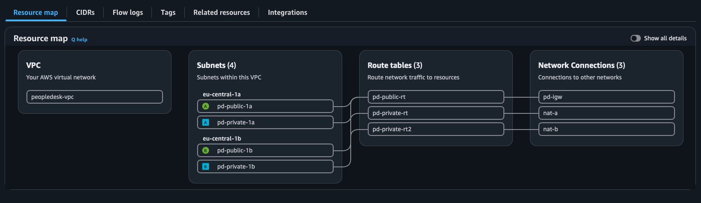 | 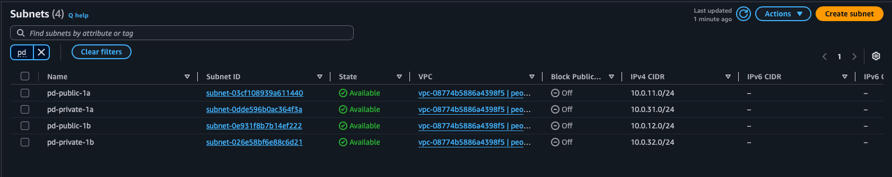 |

| NAT gateway'ler | Security group'lar |
| --- | --- |
| 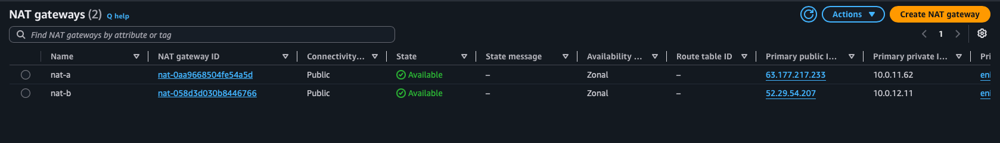 | 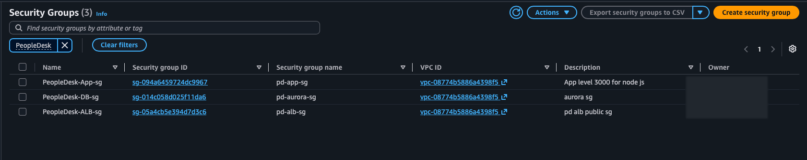 |

| ALB SG – internetten 80 | App SG – ALB SG'den 3000 | Aurora SG – App SG'den 3306 |
| --- | --- | --- |
| 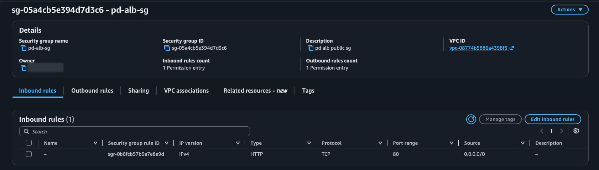 | 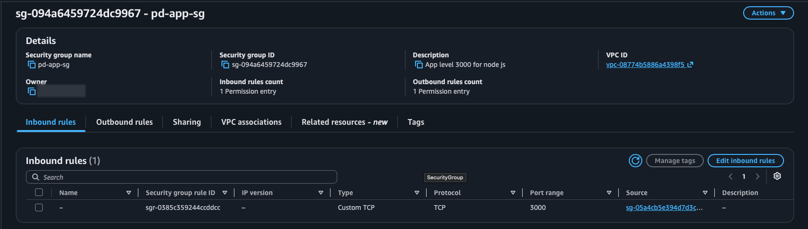 | 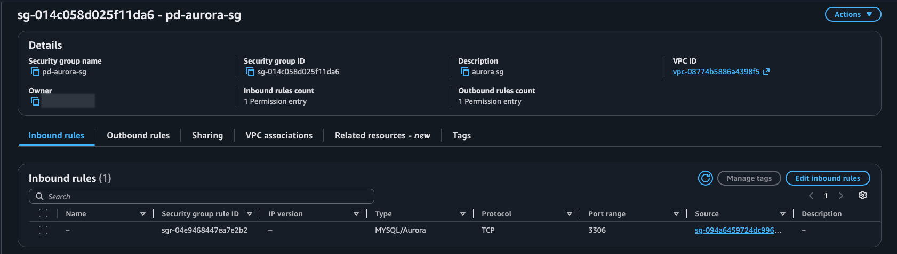 |

| Application Load Balancer | Target group sağlık durumu |
| --- | --- |
| 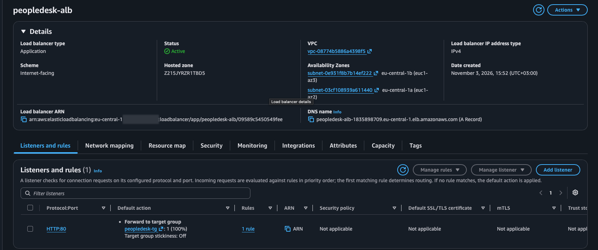 | 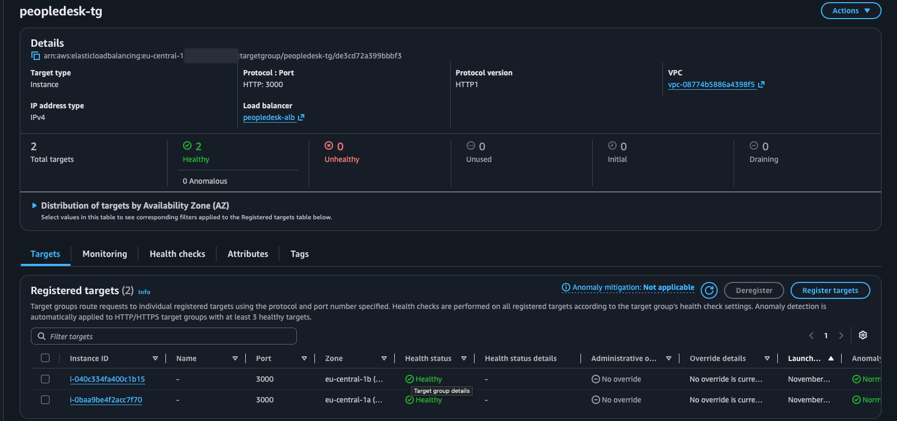 |

| EC2 instance'ları | Aurora cluster |
| --- | --- |
| 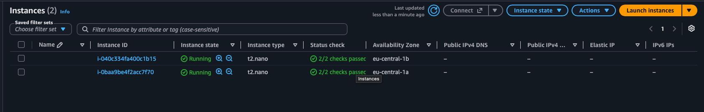 | 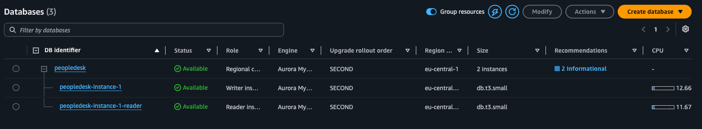 |

| IAM role | Secrets Manager |
| --- | --- |
| 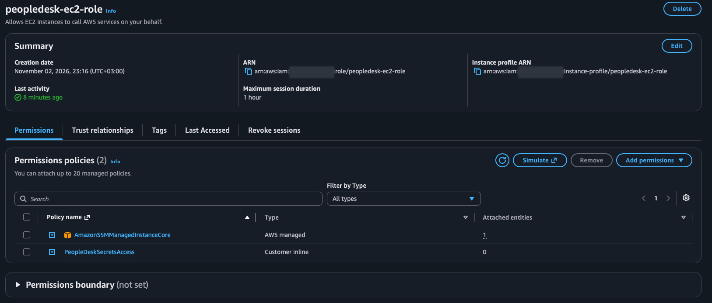 | 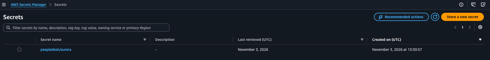 |

### Failover testleri

| EC2 durduruluyor | Arıza sırasında target group |
| --- | --- |
|  |  |

| Ayakta kalan AZ'den servis | Auto Scaling ile yenileme |
| --- | --- |
|  |  |

| Aurora failover sürüyor – roller değişti | Failover sonrası uygulama |
| --- | --- |
| 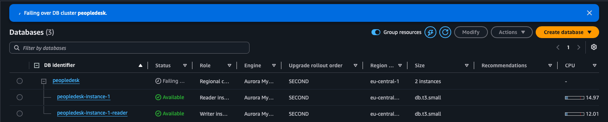 | 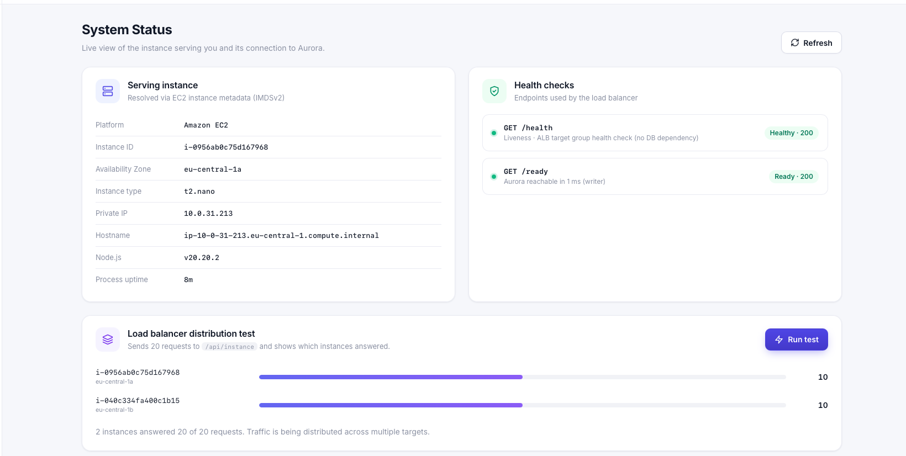 |

---

## J. Kurulum ve yapılandırma

> Tüm tanımlayıcılar için yer tutucu kullanın. Şifreleri, secret değerlerini, hesap numaralarını ya da `.env` dosyalarını asla commit etmeyin.

### Ön koşullar

- Bir AWS hesabı ve **eu-central-1** bölgesine erişim.
- [Bölüm D](#d-ağ-mimarisi)'deki ağ: VPC, 4 subnet, Internet Gateway, 2 NAT gateway, 3 route table ve 3 security group.
- Bu repository'nin instance'lardan erişilebilir olması. User data, repository'yi NAT gateway üzerinden GitHub'dan klonlar.

### 1. Aurora MySQL cluster

1. `pd-private-1a` ve `pd-private-1b` ile bir **DB subnet group** oluşturun.
2. `peopledesk` adında bir Aurora MySQL cluster'ı oluşturun:
   - `peopledesk-vpc` içinde, bu subnet group ve `pd-aurora-sg` ile;
   - **public erişim kapalı**;
   - writer'dan **farklı bir AZ'de bir reader** ile.
3. *Connectivity & security* sekmesinden **cluster (writer) endpoint**'ini kopyalayın.

### 2. Secrets Manager

**`peopledesk/aurora`** adında bir secret (*Other type of secret*) oluşturun. JSON yapısı şöyle olmalı:

```json
{
  "username": "app_user",
  "password": "<güçlü-ve-benzersiz-şifre>",
  "host": "<cluster-writer-endpoint>",
  "port": 3306,
  "database": "employee_management"
}
```

### 3. IAM role

**`peopledesk-ec2-role`** role'ünü (trusted entity: EC2) şu policy'lerle oluşturun:

- `AmazonSSMManagedInstanceCore`
- secret ARN'si üzerinde `secretsmanager:GetSecretValue` izni veren bir inline policy ([bölüm G](#g-güvenlik-tasarımı))

### 4. Launch template ve Auto Scaling group

**Launch template:**

- Amazon Linux 2023 AMI
- yukarıdaki IAM instance profile ve `pd-app-sg`
- key pair yok
- IMDSv2 (token zorunlu)
- user data:

```bash
#!/bin/bash
set -euxo pipefail
dnf install -y git
git clone https://github.com/ayberkgerey/high-availability-em.git /opt/src/peopledesk
cd /opt/src/peopledesk
AWS_REGION=eu-central-1 AWS_SECRET_NAME=peopledesk/aurora ./deployment/install.sh
```

**Auto Scaling group:**

- subnet'ler: `pd-private-1a` ve `pd-private-1b`
- `peopledesk-tg`'ye bağlı
- desired capacity **2**

### 5. Target group ve load balancer

- **Target group `peopledesk-tg`:** instance'lar, HTTP **3000**, health check yolu **`/health`**, stickiness **kapalı**.
- **ALB `peopledesk-alb`:**
  - internet-facing, `pd-public-1a` ve `pd-public-1b`'de
  - security group `pd-alb-sg`
  - listener **HTTP:80 → peopledesk-tg**

### 6. `install.sh` ne yapar

[`deployment/install.sh`](deployment/install.sh) idempotent'tir ve root olarak çalışır:

1. İşletim sistemi paketlerini, MariaDB istemcisini ve **Node.js 20**'yi kurar.
2. Oturum açamayan `nodeapp` servis kullanıcısını oluşturur.
3. `backend/`, `frontend/` ve `database/` klasörlerini `/opt/employee-management` altına kopyalar ve `npm ci --omit=dev` çalıştırır.
4. TLS için Amazon RDS CA bundle'ını indirir.
5. `AWS_REGION` boşsa bölgeyi IMDSv2 üzerinden tespit eder.
6. `/etc/employee-management/app.env` dosyasını (izin 0640) yazar. Dosyada kimlik bilgileri değil, secret'ın **adı** bulunur.
7. `employee-management` systemd servisini kurar ve başlatır.
8. `/health` ve `/ready` kontrollerini yapar.

### 7. Veritabanı kurulumu (tek seferlik)

Bir instance'a **Session Manager** ile bağlanın (EC2 → Connect → Session Manager), ardından:

```bash
# Şemayı ve örnek verileri yükle (Aurora master şifresini sorar)
mysql -h <cluster-writer-endpoint> -u <master-user> -p < /opt/employee-management/database/schema.sql

# En az yetkili uygulama kullanıcısını oluştur (şifre = secret'ta saklanan değer)
mysql -h <cluster-writer-endpoint> -u <master-user> -p
```

```sql
CREATE USER 'app_user'@'%' IDENTIFIED BY '<secret-ile-ayni-sifre>';
GRANT SELECT, INSERT, UPDATE, DELETE ON employee_management.* TO 'app_user'@'%';
```

[`database/schema.sql`](database/schema.sql) idempotent'tir. Veritabanını, iki tabloyu ve indekslerini oluşturur; 10 departman ve 34 örnek çalışan yükler.

### 8. Servisin yönetimi

```bash
sudo systemctl status employee-management       # durum
sudo systemctl restart employee-management      # yapılandırma değişikliğinden sonra yeniden başlatma
sudo journalctl -u employee-management -f       # yapılandırılmış JSON loglar
sudo cat /etc/employee-management/app.env       # çalışma zamanı yapılandırması (secret içermez)
```

### 9. Instance üzerinde sağlık kontrolü

```bash
curl -s localhost:3000/health   # {"status":"ok",...}
curl -s localhost:3000/ready    # {"status":"ready","database":{"status":"connected","role":"writer",...}}
```

### Ortam değişkenleri

| Değişken | Amaç |
| --- | --- |
| `PORT` | Uygulama portu (varsayılan `3000`, target group ile aynı olmalı) |
| `AWS_REGION` / `AWS_SECRET_NAME` | Secrets Manager modunu açar |
| `DB_HOST`, `DB_PORT`, `DB_USER`, `DB_PASSWORD`, `DB_NAME` | Yerel mod ya da secret'ta olmayan alanlar için yedek değerler |
| `DB_SSL`, `DB_SSL_CA_PATH` | Aurora'ya TLS |
| `DB_POOL_SIZE`, `DB_QUERY_RETRIES`, `DB_CONNECT_TIMEOUT_MS`, … | Pool ve dayanıklılık ayarları |

Tam liste için [`.env.example`](.env.example) dosyasına bakın. EC2'ye özel notlar [deployment/README-EC2.md](deployment/README-EC2.md) dosyasında (İngilizce).

### Yerel geliştirme

```bash
cp .env.example .env          # yalnızca yerel değerler, git'e eklenmez
docker compose up -d          # şema ve örnek verilerle MySQL 8
cd backend && npm install && npm run dev
# http://localhost:3000
```

---

## K. Test

Bu repository'de henüz otomatik bir test paketi yok. Doğrulama aşağıdaki endpoint'ler, kullanıcı arayüzü ve [bölüm H](#h-yüksek-erişilebilirlik-ve-failover-testleri)'deki manuel failover testleriyle yapılır.

```bash
ALB=<alb-dns-adi>             # EC2 → Load Balancers → peopledesk-alb

# Uygulama sağlığı (DB bağımlılığı yok) ve veritabanı hazırlığı
curl -s http://$ALB/health
curl -s http://$ALB/ready

# Hangi instance / AZ yanıt verdi
curl -s http://$ALB/api/instance

# Okuma işlemleri
curl -s "http://$ALB/api/employees?search=engineer&pageSize=5"
curl -s http://$ALB/api/dashboard

# Oluşturma (yeni id ile 201 döner; aynı e-posta tekrar gönderilirse 409)
curl -s -X POST http://$ALB/api/employees -H "Content-Type: application/json" -d '{
  "firstName": "Test", "lastName": "User", "email": "test.user@example.com",
  "jobTitle": "Cloud Engineer", "department": "Engineering",
  "employmentType": "Full-time", "status": "Active",
  "hireDate": "2026-11-03", "location": "Frankfurt, Germany", "salary": 75000
}'

# Güncelleme / silme
curl -s -X PUT    http://$ALB/api/employees/<id> -H "Content-Type: application/json" -d '{ ...tam gövde... }'
curl -s -X DELETE http://$ALB/api/employees/<id> -o /dev/null -w "%{http_code}\n"   # 204
```

**Load balancer dağılımı:**

```bash
for i in $(seq 1 20); do
  curl -s -D - -o /dev/null http://$ALB/health | grep -i x-served-by
done | sort | uniq -c
```

Her yanıt bir `X-Served-By: <instance-id> (<az>)` başlığı taşır. İki sağlıklı target varken iki instance da görünmelidir. Arayüzdeki **System Status → Run test** butonu aynı kontrolü `/api/instance` üzerinden yapar.

**Yüksek erişilebilirlik kontrolleri:**

- **Instance arızası:** yukarıdaki döngü çalışırken bir instance'ı durdurun ya da sonlandırın, ardından [Test 1](#test-1--ec2-instance-arızası-ve-auto-scaling-ile-kurtarma)'i takip edin.
- **Veritabanı failover'ı:** cluster'da **Actions → Failover** çalıştırırken `/ready`'yi saniyede bir sorgulayın, ardından [Test 2](#test-2--aurora-veritabanı-failover-testi)'yi takip edin.

---

## L. Maliyet değerlendirmesi

Bu bir **portfolyo / lab ortamıdır**. Kesin fiyatlar bölgeye, kullanıma ve güncel AWS fiyat listesine bağlı olduğu için burada aylık rakam verilmemiştir. Başlıca maliyet kalemleri şunlardır:

| Kaynak | Maliyeti belirleyen | Notlar |
| --- | --- | --- |
| **NAT Gateway (×2)** | Gateway başına saatlik ücret ve GB başına veri işleme | Küçük bir lab'da genellikle en büyük sabit maliyettir. **Boşta da ücretlendirilir**; durdurulamaz, yalnızca silinebilir |
| **Aurora MySQL (×2 instance)** | Instance başına saatlik ücret, depolama ve I/O, ücretsiz kotayı aşan yedek depolama | Durdurulan bir cluster 7 gün sonra otomatik olarak yeniden başlar. Cluster var olduğu sürece depolama ücreti işler. Eski ana sürümler **Extended Support** ücretine tabi olabilir |
| **Application Load Balancer** | Saatlik ücret ve Load Balancer Capacity Unit (LCU) | Trafik olmasa da var olduğu sürece ücretlendirilir |
| **EC2 (×2, `t2.nano`)** | Saatlik instance ücreti ve EBS volume'leri | Auto Scaling group içindeki bir instance'ı durdurmak yenisinin açılmasına yol açar. Bunun yerine desired capacity 0 yapılmalı |
| **Public IPv4 adresleri** | NAT gateway'lerdeki Elastic IP'ler ve ALB'nin public IP'leri | Saatlik ücretlendirilir; hiçbir kaynağa bağlı olmayan Elastic IP'ler de dahil |
| **Veri transferi** | İnternete çıkış, ALB, EC2 ve Aurora arasındaki AZ'ler arası trafik, NAT işleme | Lab için düşük, ancak trafikle birlikte artar |
| **Secrets Manager** | Secret başına aylık ücret ve API çağrıları | Düşük |

Tüm ücretleri durdurmak için **silme sırası**:

1. Auto Scaling group'u silin; instance'larını da sonlandırır.
2. ALB'yi, ardından target group'u silin.
3. Aurora instance'larını (önce reader, sonra writer), ardından cluster'ı silin.
4. NAT gateway'leri silin ve **Elastic IP'lerini serbest bırakın**.
5. Secret'ı ve launch template'i silin.
6. VPC'yi silin.

---

## M. Öğrenilen dersler

- **Multi-AZ, ağ dahil her katman demektir.** Her iki private subnet tek bir NAT gateway üzerinden çıkıyorsa iki uygulama instance'ı yüksek erişilebilirlik sağlamaz. Bu gizli tek hata noktasını ortadan kaldırmak için AZ başına bir NAT gateway'e yönlendiren, AZ başına ayrı bir private route table gerekti.
- **Health check, load balancer'ın düzeltebileceği şeyi ölçmeli.** `/health`'in veritabanından bağımsız tutulması, bir veritabanı failover'ının tüm target'ları aynı anda sağlıksız göstermesini engeller. Veritabanı durumu ayrıca `/ready` ile izlenir.
- **Aurora'da rol, kimlik değildir.** Failover'dan sonra adı `…-instance-1-reader` olan instance writer oldu. Uygulamalar **cluster writer endpoint**'ini kullanmalı ve operasyon dokümanları bir instance'ın rolünü adından çıkarmamalıdır.
- **Failover aynı zamanda bir uygulama sorumluluğudur.** Yükseltmeyi Aurora yapar, ancak istemcinin kopmuş ya da salt okunur bağlantıları atması, DNS'i yeniden çözmesi ve güvenli şekilde tekrar denemesi gerekir. Okumalar tekrar denenebilir; yarıda kalan yazmalar körü körüne tekrarlanmamalıdır.
- **Auto Scaling istenen durumu zorla korur.** Elle durdurulan bir instance sonlandırılıp yenisiyle değiştirildi. Kendi kendini onarma için bu iyi bir şey, ancak ASG içindeki instance'lar maliyet için "duraklatılamaz"; kapasitenin group üzerinden değiştirilmesi gerekir.
- **User data yalnızca ilk açılışta çalışır.** Instance'lar ilk kez çalışan bir dışarı çıkış rotası olmadan açıldığında kurulum başarısız oldu. Doğru çözüm, eski instance'ları yamamak değil, ağı düzeltip ASG'nin yeni instance'lar açmasını sağlamaktı.
- **Bazı ayarlar oluşturma anında sabitlenir.** Bir Aurora cluster'ı oluşturulduktan sonra başka bir VPC'ye taşınamaz. *Create*'e basmadan önce VPC'yi, DB subnet group'u ve security group'u kontrol etmek yeniden kurulumdan kurtarır. Endpoint'i bir instance'tan çözümleyince (`getent hosts`) `172.31.x.x` adresi dönmesi, cluster'ın default VPC'de oluşturulduğunu hızlıca gösterdi.
- **Security group kuralı, trafiği karşılayan tarafa yazılır.** 3306 kuralı veritabanı security group'unda bulunur ve uygulama security group'una referans verir, tersi değil. Security group referansları, ASG instance'larının IP'leri değiştiğinde de çalışmaya devam eder.
- **IAM role ile Secrets Manager, koca bir sorun sınıfını ortadan kaldırır.** Sunucularda sızdırılacak ya da döndürülecek anahtar yoktur. Sorun gidermede `/ready` ile yapılandırılmış logların (`journalctl -u employee-management`) birlikte kullanılması, ağ, IAM ve kimlik bilgisi hatalarını ayırt etmeyi kolaylaştırdı.
- **Session Manager dışarı çıkış bağlantısına ihtiyaç duyar.** "Instance is not connected" hataları security group'lardan değil, eksik NAT rotalarından ve hâlâ açılmakta olan instance'lardan kaynaklandı. Inbound bir port gerekmez.
- **Varsayılanlara dikkat edin.** Büyük instance sınıfları ya da eski engine sürümleri gibi konsol varsayılanlarının doğrudan maliyet etkisi vardır. Her ayar bilinçli bir seçim olmalı.

---

## N. Gelecek geliştirmeler

Aşağıdakiler mevcut dağıtımda **uygulanmamıştır**:

- **Infrastructure as Code:** Terraform (ya da AWS CDK) ile VPC, ALB, ASG, Aurora, IAM ve secret'ların tanımlanması. Böylece ortam tek komutla yeniden kurulup kaldırılabilir.
- **HTTPS:** ALB'de ACM sertifikası, HTTP → HTTPS yönlendirmesi ve HSTS.
- **AWS WAF:** ALB önünde managed rule group'lar ve rate limiting.
- **Amazon CloudWatch** izleme:
  - uygulama logları için CloudWatch agent;
  - ALB 5xx hataları, sağlıksız host sayısı, Aurora CPU ve bağlantı sayısı ile NAT hataları için alarmlar;
  - bir dashboard.
- **Amazon RDS Proxy:** connection pooling, daha hızlı failover yönetimi ve IAM veritabanı kimlik doğrulaması.
- **Okuma/yazma ayrımı:** salt okunur sorguların Aurora reader endpoint'ine yönlendirilmesi.
- **CI/CD pipeline** (örneğin GitHub Actions): otomatik testler, sürümlenmiş build çıktıları ve launch template sürümleri ya da ASG instance refresh ile kademeli dağıtım.
- **Otomatik testler:** servisler ve doğrulama için unit ve integration testleri; hata oranını ve toparlanma süresini ölçen scriptli failover testleri.
- **Ölçekleme politikaları:** CPU ya da target başına ALB istek sayısına göre target tracking; minimum ve maksimum kapasitenin dokümante edilmesi.
- **VPC interface endpoint'leri:** Secrets Manager ve SSM için. Böylece AWS API trafiği NAT yolundan çıkmaz.
- **Secret rotasyonu:** bir Secrets Manager rotasyon fonksiyonu ile.
- **Aurora MySQL 3 (MySQL 8.0):** cluster eski bir ana sürümdeyse, desteklenen bir instance sınıfıyla birlikte yükseltme.
- **Kimlik doğrulama ve yetkilendirme:** örneğin rol tabanlı erişimle Amazon Cognito.
- **Daha sıkı egress kuralları** ve geniş kapsamlı managed policy yerine özel bir SSM policy'si.

---

## Lisans

MIT. Öğrenme ve portfolyo amaçlı serbestçe kullanılabilir.
